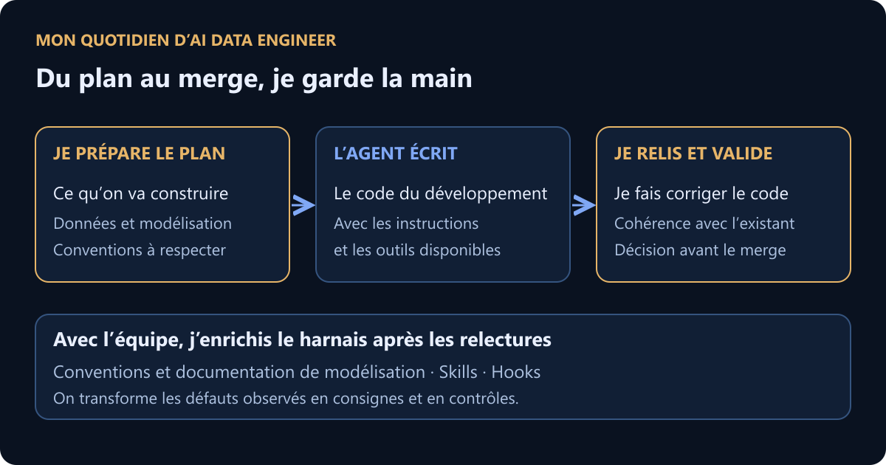
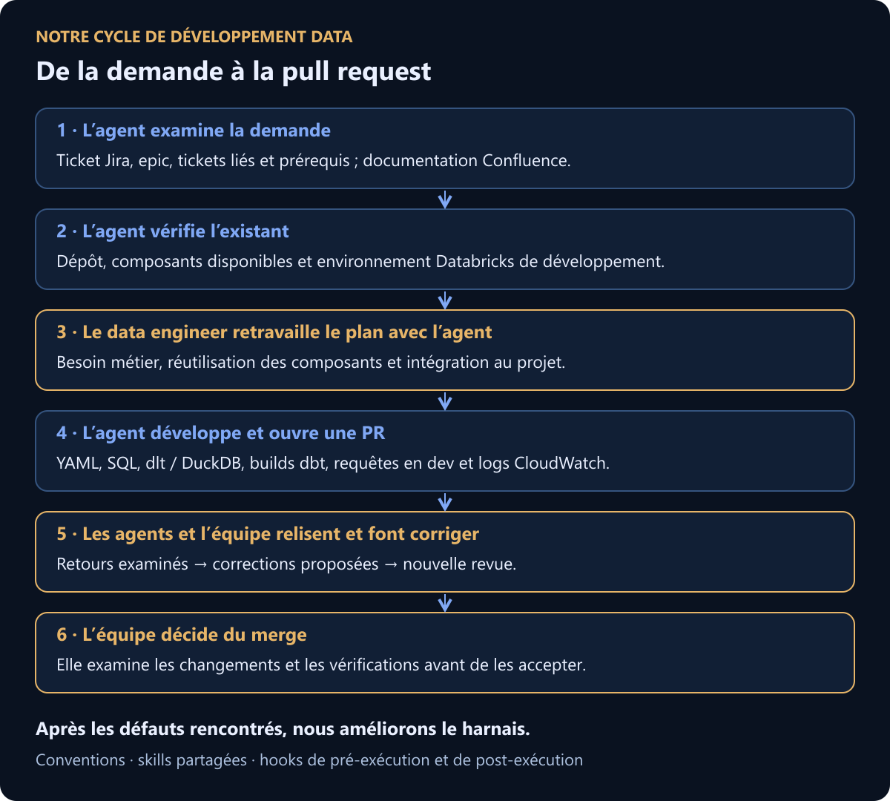
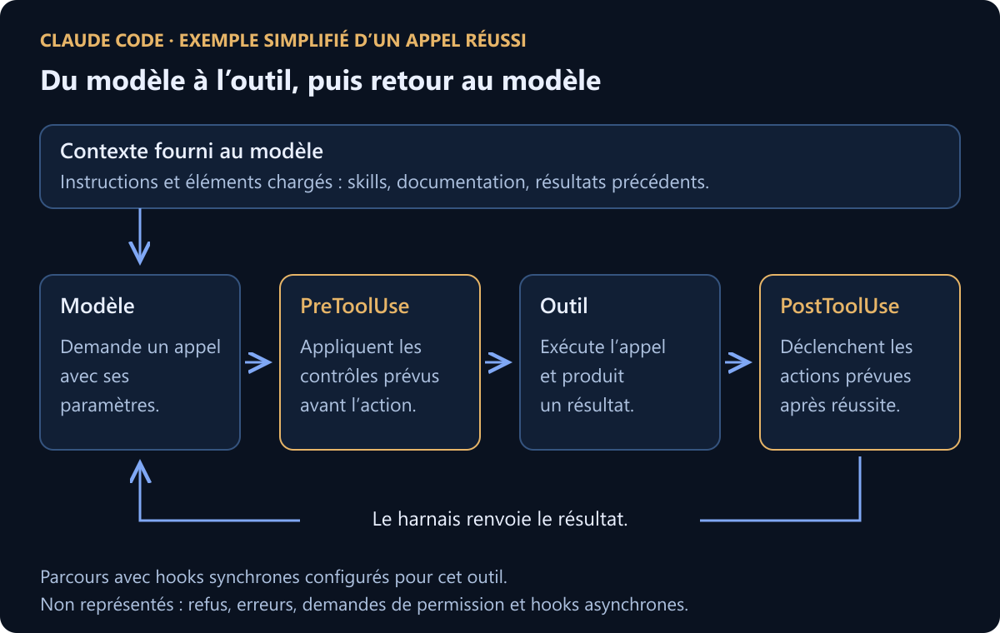

Relire une pull request, retrouver une convention, préparer un message de commit : dans une journée de data engineer, ces tâches reviennent entre deux développements. Chacune peut servir de premier essai avec l’IA. Nous connaissons les éléments à fournir et nous savons juger le résultat. Nous pouvons observer ce que l’assistant oublie, ce qu’il faut lui expliquer et le temps que nous passons à corriger sa proposition.

C’est l’intérêt de commencer par des micro-tâches. Une review donne un terrain pour apprendre : le code existe, l’équipe connaît les règles et un collègue peut contester les remarques de l’agent. Avant de lui confier davantage de travail, nous pouvons examiner ce qu’il fait sur ce périmètre.

Chez un client, nous avons commencé par des agents de review. Aujourd’hui, nous partageons des skills qui couvrent plusieurs étapes du développement : lire une demande dans Jira, consulter la documentation dans Confluence, vérifier l’existant, préparer un plan, écrire le code et ouvrir une pull request. D’autres agents interviennent dans la revue, puis nous examinons les retours et les corrections. L’équipe garde la décision de merge.

- **Commencer par une tâche vérifiable** : nos premières reviews IA accompagnaient la formation des collègues et le renforcement des tests.
- **Relier les étapes** : nous partageons des skills pour passer de la demande au plan, au code et à la PR.
- **Améliorer la qualité et garder la décision dans l’équipe** : nous observons moins de retours de recette et l’équipe garde la décision de merge.

## Nous avons commencé par aider les collègues à relire leur code

Notre premier usage couvrait quatre périmètres : l’infrastructure décrite en code, les transformations dbt, les containers et les pipelines Airflow. Les agents intervenaient dans GitHub pour relire les pull requests. Ils examinaient les conventions, les bugs, la sécurité et la qualité des tests. Les collègues pouvaient demander une nouvelle review après une correction.

Nous leur avions fourni les instructions et les bonnes pratiques de l’équipe. Ces agents participaient à un travail plus large : accompagner des data analysts vers le métier d’analytics engineer, les former aux développements dbt et renforcer les tests et les revues.

Nous avons observé moins de changements qui cassaient dbt dès les premières reviews automatiques. Au fil de cet accompagnement, nous avons constaté une nette amélioration de la qualité du code et de moins en moins de retours de recette sur les développements de nos analytics engineers. Les collègues ont appris et pris confiance. Je rattache cette progression à l’ensemble de l’accompagnement : les agents, les formations, les tests et les échanges entre collègues.

Cette première étape permettait d’observer les résultats. Nous pouvions lire une remarque, vérifier si elle s’appliquait au code et demander une correction. Nous avons ensuite étendu le travail confié aux agents à d’autres étapes du développement.

## Notre plateforme leur fournit un cadre de travail

Un agent qui doit ajouter une source de données a besoin de comprendre le projet. Où se trouve le connecteur ? Comment déclare-t-on une ingestion ? Quels modèles dépendent de cette source ? Quels tests faut-il prévoir ?

Dans la data platform présentée lors de notre conférence à Nantes, j’ai décrit une approche « data platform as code ». Nous décrivons l’infrastructure avec Terraform et Helm, déclarons les pipelines en YAML et écrivons les transformations en SQL avec dbt. Nous conservons aussi les conventions et les décisions dans la documentation du projet.

Le parcours des données suit plusieurs étapes : nous les collectons depuis les systèmes sources avec dlt, conservons le brut en bronze, puis préparons les données en silver et les modèles destinés aux usages en gold. Airflow orchestre ces traitements. Pour les sources prises en charge par nos composants, les déclarations réutilisent la mécanique d’orchestration existante.

Ce choix réduit le nombre de décisions à réinventer pour chaque développement. L’agent peut examiner des fichiers, retrouver des exemples et proposer une modification dans le même dépôt. Les reviewers disposent ensuite du diff pour comprendre ce qui change.

Nous devons aussi écrire les règles que l’agent doit appliquer. Une règle métier qui reste dans la tête d’un collègue exigera un échange avec lui. Même lorsqu’il dispose du contexte, l’agent peut proposer un développement qui ignore une convention implicite : je l’ai constaté pendant la relecture d’un plan.

## De la demande Jira au plan que nous acceptons

Le cycle commence par la demande. L’agent lit le ticket Jira, l’epic auquel il appartient et les tickets connexes, ainsi que les spécifications et la user story. Il cherche les dépendances : un autre ticket doit-il être réalisé avant celui-ci ? Il consulte aussi la documentation dans Confluence et liste les informations manquantes.

Si des éléments manquent, l’utilisateur peut décider de lui faire publier un commentaire sur le ticket, en mentionnant le Product Owner (PO) avec @ pour lui présenter cette liste.

Pour une nouvelle source, connaître son nom ne suffit pas. Il faut comprendre ce que le métier veut en faire et ce que la plateforme doit produire. Une demande incomplète peut conduire à un développement cohérent avec une mauvaise interprétation du besoin.

Pendant qu’il lit le ticket et recherche les éléments existants nécessaires à sa réalisation, une skill lui permet de requêter l’environnement Databricks de développement. Il peut vérifier l’état de la stack : la source attendue est-elle présente ? Les composants nécessaires existent-ils ? Ces vérifications l’aident à préparer un plan adapté au projet.

Nous retravaillons ce plan ensemble. C’est l’un des moments où mon expérience du projet intervient le plus.

<aside class="definition" aria-label="Retour d’expérience sur la réutilisation du connecteur">

**Le connecteur existait, la règle restait implicite**

Pendant une relecture, j’ai vu que l’agent prévoyait de recréer un connecteur présent dans le contexte qu’il avait enregistré. Nous n’avions pas écrit noir sur blanc la règle de réutilisation. Je lui ai demandé de reprendre le connecteur existant avant qu’il commence à coder.

</aside>

Dans Airflow, je rencontre un problème voisin : une fonction dédiée à une datasource peut reproduire ce qu’un helper générique permettrait de partager.

Je vérifie donc le besoin et la manière de l’intégrer à ce que nous maintenons. Une réponse correcte à la demande peut ajouter une duplication que l’équipe devra gérer ensuite.

## Du plan au code, puis à la pull request

À partir du plan retravaillé, l’agent prépare le développement. Pour une nouvelle source, cela peut comprendre les déclarations YAML, les transformations SQL et les tests associés. L’étendue du travail dépend de ce que nos composants prennent déjà en charge.

_Je prépare le plan, l’agent développe et je garde la décision de merge. Les relectures nous aident à améliorer le cadre de travail._

Pour les nouvelles données, une skill dlt lui permet de lancer une extraction de test dans DuckDB : vérifier les types attendus, rechercher une clé primaire ou composite et identifier un curseur pour un chargement incrémental en mode `merge`, par exemple. L’équipe valide ces choix au regard du sens métier et des cas que les données de test ne couvrent pas.

Pendant l’implémentation, l’agent peut lancer des builds dbt de test pour vérifier les modèles concernés et leurs dépendances, afin de repérer une régression ailleurs dans le projet. Il peut aussi consulter les logs des exécutions dans CloudWatch. Ces résultats l’aident à poursuivre le développement et à préparer les corrections.

L’agent rédige aussi les messages de commit et ouvre la pull request. Nous retrouvons dans GitHub le code proposé et les échanges nécessaires à sa revue.

La PR constitue un point de passage utile pour l’équipe : nous pouvons examiner les modifications et suivre les corrections dans le même contexte. L’ouverture de la PR ne suffit pas pour accepter le développement. Nous devons encore vérifier le comportement du code et sa cohérence avec le projet.

_Le cycle comprend des échanges et des reprises. Nous pouvons revenir au plan si la revue révèle un problème de conception._

## Les agents relisent ; l’équipe examine les retours et décide

D’autres agents interviennent sur la pull request. Ils apportent leurs remarques sur le code proposé. À chaque retour, l’agent de développement lit le commentaire, en vérifie la pertinence et propose une correction.

Je tiens à cette vérification. Une remarque de review peut mal interpréter le contexte. Modifier le code pour satisfaire tous les commentaires sans les examiner déplacerait le problème. L’équipe doit pouvoir comprendre le désaccord et choisir la correction à retenir.

Le cycle alterne donc revue et corrections. Nous relisons le résultat, demandons les ajustements nécessaires et décidons du merge. L’accord entre plusieurs agents reste un élément de la revue ; nous gardons la responsabilité d’accepter le changement.

Après le merge et le déploiement en développement, l’agent peut effectuer une sorte de pré-recette dans Databricks : vérifier que les objets créés correspondent à la demande initiale et repérer d’éventuels bugs qui n’étaient pas anticipés.

Les tests font partie de ce travail. Nous devons regarder ce qu’ils couvrent et ce qu’ils laissent de côté. Dans mon quotidien, certains développements vont de l’ingestion bronze à la modélisation gold, avec les tests de bout en bout et le déploiement sur les environnements. Pour juger le résultat, je dois conserver cette vue du parcours complet.

## Nous partageons les skills et améliorons le harnais

Pour reprendre ce fonctionnement entre collègues, nous partageons et co-construisons des skills. J’emploie ce terme pour désigner des instructions et des procédures réutilisables que l’agent peut suivre pour une tâche donnée.

Dans notre équipe, elles couvrent plusieurs tâches du cycle :

| Skill                       | Usage dans le développement                                                                                                                                                                                              |
| --------------------------- | ------------------------------------------------------------------------------------------------------------------------------------------------------------------------------------------------------------------------ |
| Jira                        | Lire le ticket, son epic et les tickets liés, repérer les prérequis. Si des informations manquent, publier sur décision de l’utilisateur un commentaire qui les liste et mentionne le PO avec @.                         |
| Confluence                  | Consulter ou enrichir la documentation.                                                                                                                                                                                  |
| Sources de données          | Créer une source à partir des spécifications et des user stories.                                                                                                                                                        |
| Databricks de développement | Requêter l’environnement pendant la lecture du ticket et la recherche des éléments existants ; après le merge et le déploiement en développement, effectuer une sorte de pré-recette.                                    |
| dlt                         | Extraire les nouvelles données dans DuckDB pour les tester : vérifier les types attendus, rechercher une clé primaire ou composite et identifier un curseur pour un chargement incrémental en mode `merge`, par exemple. |
| dbt                         | Lancer des builds de test pendant les implémentations.                                                                                                                                                                   |
| CloudWatch                  | Lire les logs des exécutions.                                                                                                                                                                                            |

<aside class="definition" aria-label="Définition du harnais d’agent">

**Le harnais d’agent**

Cette couche logicielle fournit le contexte au modèle, exécute ses appels d’outils et lui renvoie les résultats. Elle porte aussi les mécanismes de contrôle de ses actions. Le terme vient de l’anglais _agent harness_. [Définition chez Anthropic](https://www.anthropic.com/research/managed-agents).

</aside>

Nous configurons ce harnais avec nos instructions, nos skills et des hooks de pré-exécution et de post-exécution. Ces hooks interviennent avant ou après les opérations concernées, pour appliquer les contrôles et les actions prévus. La documentation et les conventions fournissent le contexte et les règles que l’agent doit suivre.

_Ce schéma illustre un appel réussi dans Claude Code. `PreToolUse` peut empêcher l’appel ; `PostToolUse` intervient après sa réussite et n’annule pas l’action effectuée. En cas d’échec, Claude Code déclenche `PostToolUseFailure`. [Référence officielle des hooks](https://code.claude.com/docs/en/hooks#hook-lifecycle)._

Git nous a fourni un exemple concret. Le comportement non déterministe de l’agent se voyait dans sa manière de nommer les branches, d’effectuer un commit ou d’ouvrir les PR : il pouvait changer de procédure d’une exécution à l’autre. Il tentait aussi des push directs sur `main`. GitHub les bloquait, mais il lui arrivait de réessayer. Nous perdions du temps et des tokens sur une action qui allait échouer.

Nous avons ajouté des skills, des règles et des hooks pour guider ces opérations et bloquer certaines actions avant leur exécution. Nous procédons de la même façon pour les défauts de code qui reviennent : préciser une convention, documenter un choix de modélisation ou ajouter un contrôle.

Nous alimentons ce cadre avec ce que nous observons pendant les développements. Certains défauts récurrents ne sont plus revenus depuis ces ajustements. D’autres demandent encore une relecture : nous n’avons pas traduit toute notre connaissance du projet en instructions.

## Ce que cette pratique a changé dans mon travail

Depuis janvier, l’IA écrit le code que je livre. Je consacre l’essentiel de mon temps à préparer le plan, relire les propositions et faire corriger ce qui ne convient pas. Mon expérience data me sert à choisir ce que nous construisons et à juger son intégration dans la plateforme.

Sur certains pipelines, j’arrive à livrer en moins d’une demi-journée, tests et déploiement compris. J’estime que des développements comparables m’auraient demandé un à deux jours auparavant. Il s’agit de mon expérience sur ces cas, avec notre plateforme et nos pratiques, pas d’une mesure contrôlée ni d’un délai applicable à chaque demande.

Les composants réutilisables, les conventions, les tests et l’accompagnement des collègues comptent dans ces gains de temps et de qualité.

## Trois développements en parallèle, et je finis sur les rotules

Avec les worktrees d’Orca, je mène maintenant plusieurs développements en parallèle, chacun dans son espace de travail. Je peux avancer sur une autre demande pendant qu’un agent exécute une tâche. Cela me permet d’augmenter encore le volume de travail traité.

<aside class="definition" aria-label="Limite humaine du travail en parallèle">

**Ma limite : trois développements en parallèle**

À partir de trois développements en parallèle, je finis les journées sur les rotules. Certaines features touchent nos quatre dépôts à la fois. Je dois garder en tête les plans, les dépendances entre les changements et les retours de review de chaque développement.

</aside>

La charge cognitive est énorme. Les agents peuvent poursuivre plusieurs tâches en même temps ; de mon côté, je dois passer d’un contexte à l’autre et conserver assez d’attention pour juger les propositions. Avec un humain dans la boucle, le nombre de développements que nous pouvons suivre dépend aussi de sa capacité à les relire. Pour moi, ce seuil de fatigue fait partie du bilan, au même titre que le temps gagné et la qualité du code.

## Commencer par une tâche que l’équipe sait vérifier

Pour une équipe qui commence, je choisirais une tâche dont elle sait vérifier le résultat. Une review peut convenir. Il faut compter le temps passé à préparer la demande, lire la proposition et corriger les erreurs, puis conserver ce qui permet à un collègue de refaire l’essai.

La tâche suivante peut prolonger ce travail : préparer le plan avant le développement, puis relier le développement à la revue. C’est ainsi que nous pouvons étendre le périmètre confié aux agents, en examinant les difficultés à chaque passage. Aujourd’hui, notre cycle couvre la demande jusqu’à la PR ; nous continuons à l’améliorer à partir des retours de l’équipe.

Au fond, nous avons construit tout cela avec du bon sens, du pragmatisme et des essais-erreurs. Nous essayons sur une tâche, observons les résultats et corrigeons ce qui ne fonctionne pas. Puis nous partageons ce que nous avons appris avec l’équipe avant d’aller plus loin.
