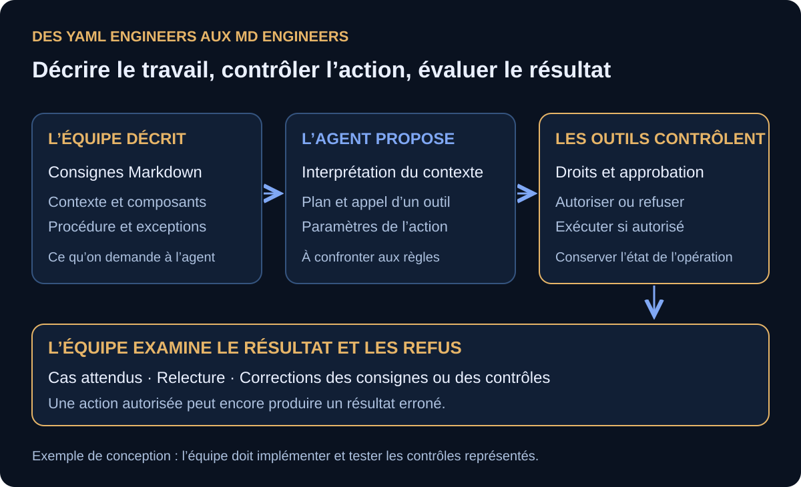
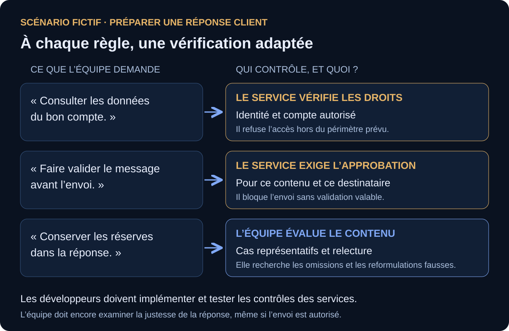
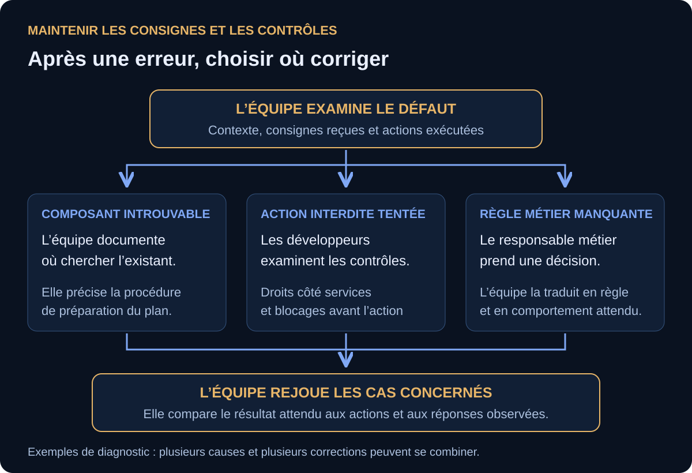

<div class="tldr">

- **Contexte :** guider l’agent vers les composants et les conventions du projet, puis relire son plan.
- **Contrôles :** relier les consignes aux droits et aux refus que les outils font respecter.
- **Évaluation :** rejouer les cas concernés pour vérifier les résultats et corriger les règles.

</div>

Dans mes dépôts, je passe une partie de mon temps à écrire des fichiers Markdown pour expliquer à un agent comment travailler. Les conventions du projet, les composants à réutiliser, la façon de préparer une PR. Puis je relis le code qu’il produit et je fais corriger ce qui ne convient pas.

Après les « YAML engineers », allons-nous devenir des « MD engineers » ?

La formule me plaît. Elle décrit une partie de ce que je fais avec l’IA, avec le même risque de raccourci : regarder l’extension du fichier et oublier les décisions qu’on doit prendre pour l’écrire.

[Alejandro Saucedo emploie la même comparaison](https://www.linkedin.com/posts/axsaucedo_in-2026-we-all-have-been-promoted-from-yaml-activity-7479776201381965824-8he_) pour décrire son passage des outils Kubernetes aux systèmes agentiques. Il insiste sur le contexte fourni aux agents et la capacité à vérifier leur travail. Je retrouve cette question dans mes dépôts : comment rendre les décisions de l’équipe accessibles à l’agent, puis vérifier ce qu’il en fait ?

Dans mes développements, je prépare le plan avec l’agent, lui confie le code, puis relis ses propositions avant le merge. Pour organiser ce parcours, il faut expliquer le travail attendu aux agents, puis prévoir comment vérifier leurs actions. C’est sur cette articulation que j’accompagne les équipes : formaliser leur pratique, outiller les contrôles et apprendre à juger les résultats.

## Derrière le YAML, on concevait déjà un système

Prenez un manifeste Kubernetes. Vous pouvez y décrire un déploiement, le nombre de réplicas ou les ressources demandées. L’outil interprète des champs définis et ses contrôleurs cherchent à rapprocher l’état du système de l’état souhaité. [La documentation Kubernetes décrit ce fonctionnement déclaratif](https://kubernetes.io/docs/concepts/overview/working-with-objects/).

L’ingénieur doit encore choisir ces valeurs, comprendre les dépendances et examiner ce qui se passe en cas de panne. Vous pouvez écrire un YAML valide et déployer un service dont vous avez sous-estimé les besoins.

Le surnom « YAML engineer » réduit ce travail à la saisie d’une configuration. Avec « MD engineer », nous risquons de faire la même chose : compter les lignes de consignes sans examiner la conception du système auquel nous les confions.

## Avec le Markdown, on décrit aussi une façon de travailler

Les agents de développement disposent de fichiers pour recevoir le contexte du projet. Dans un `AGENTS.md`, une équipe peut préciser les commandes de test et les conventions de contribution. [Le format prévoit cet usage](https://agents.md/).

J’emploie ici « MD engineer » pour parler de l’ingénieur qui formalise le travail confié aux agents. Le nom désigne une pratique, sans prétendre définir un nouveau métier ni un standard commun à tous les outils.

Dans ma pratique, j’écris ce que l’agent doit regarder avant de proposer une solution. Quel composant existe déjà ? Quelle convention de modélisation faut-il respecter ? Quels contrôles doit-il lancer avant de me soumettre son travail ?

J’en ai donné un exemple dans [« De Jira à la pull request »](/de-jira-a-la-pull-request-mes-agents-ia-au-travail/#de-la-demande-jira-au-plan-que-nous-acceptons) : pendant la relecture d’un plan, j’ai repéré que l’agent voulait recréer un connecteur existant. Je lui ai demandé de le réutiliser avant qu’il commence à coder.

Pour préparer les développements suivants, je peux documenter où chercher les connecteurs et demander à l’agent d’examiner les composants disponibles dans son plan. Je dois encore relire ce plan. La consigne aide à orienter sa recherche ; je vérifie qu’il a trouvé le bon composant et compris ses limites.

## Choisir ce que l’agent doit lire

Anthropic décrit le [context engineering](https://www.anthropic.com/research/effective-context-engineering-for-ai-agents) comme le travail de sélection et de maintien des informations fournies au modèle : instructions, outils, données et historique. Pour notre connecteur, indiquer son existence ne suffit pas. L’agent doit pouvoir retrouver son interface, ses usages et les tests qui décrivent son comportement.

Dans son [retour d’expérience sur le harness engineering](https://openai.com/index/harness-engineering/), l’équipe OpenAI raconte avoir remplacé un gros fichier de consignes par un point d’entrée court vers une documentation organisée dans le dépôt. Elle contrôle aussi la structure et les liens de cette documentation. Ce choix donne une piste concrète : conserver une source par information et guider l’agent vers les passages utiles à sa tâche.

Les [Agent Skills présentées par Anthropic](https://www.anthropic.com/research/equipping-agents-for-the-real-world-with-agent-skills) permettent de regrouper une procédure, ses ressources et des scripts. L’agent charge les détails lorsqu’il en a besoin. Une équipe peut ainsi séparer ses conventions de contribution d’une procédure spécialisée, par exemple la préparation d’une migration. Elle doit encore vérifier que son outil charge cette procédure au bon moment.

Je distinguerais aussi les conventions durables du dépôt et la spécification d’un changement. Dans son [analyse du spec-driven development](https://martinfowler.com/articles/exploring-gen-ai/sdd-3-tools.html), Birgitta Böckeler distingue la spécification écrite avant le code, celle que l’équipe maintient avec le code et celle qu’elle utilise comme source principale. Conserver une spécification exige de décider qui la met à jour. Pour une évolution de pipeline, je proposerais de décrire le résultat attendu et les cas limites dans le document de la tâche, avec des liens vers les conventions existantes.

## Une consigne écrite laisse une part d’interprétation

Dans une configuration structurée, l’outil définit le sens des champs qu’il accepte. Avec une consigne en langage naturel, le modèle doit interpréter ce qu’on attend dans le contexte de sa tâche.

« Respecte l’architecture » laisse une marge énorme. Même une demande plus précise peut poser problème si l’agent manque d’informations ou rencontre deux instructions contradictoires. L’équipe doit connaître les règles de chargement et de priorité de son outil, puis observer ce que l’agent fait sur ses cas d’usage.

Anthropic distingue à ce titre les instructions données au modèle des mécanismes de contrôle exécutés autour de lui. L’éditeur recommande les permissions et les hooks pour faire respecter les interdictions qui exigent un blocage. [Son guide détaille cette distinction](https://claude.com/resources/articles/steering-claude-code-skills-hooks-rules-subagents-and-more).

J’ai rencontré cette différence avec Git. L’agent essayait de pousser sur `main`. GitHub bloquait ces tentatives grâce aux règles du dépôt, mais l’agent pouvait recommencer. Nous avons enrichi les consignes et ajouté des contrôles pour encadrer ces opérations.

Dans ce cas, l’équipe travaille à deux endroits : elle explique le parcours attendu à l’agent et elle maintient le refus côté dépôt. Une instruction oubliée ou mal interprétée doit encore rencontrer ce refus.

Je fais une distinction voisine dans [mon retour sur Orca](/orca/#ce-quorca-nest-pas) : le worktree sépare les fichiers et les branches, mais l’agent conserve les droits du compte qui l’exécute. L’équipe doit examiner ces droits pour savoir quelles actions il peut effectuer.



Le schéma distingue ce que l’équipe demande, ce que les outils permettent et ce qu’elle vérifie après l’exécution. Écrire une règle dans un fichier ne prouve ni son application ni la justesse du résultat.

## Écrire une règle oblige à préciser le métier

Prenons un scénario fictif : une équipe prépare une réponse sur la disponibilité d’un produit et son délai de livraison.

Une première consigne pourrait tenir en une phrase : « Vérifie le stock et réponds au client. » Le rédacteur doit pourtant résoudre plusieurs questions avant de confier cette tâche à un agent. Un stock positif signifie-t-il qu’on peut livrer ? Qui confirme le délai ? Que fait-on si la source est trop ancienne ?

Pour ce scénario, je proposerais la consigne de travail suivante. Cet extrait illustre un contenu Markdown ; il ne correspond à aucune syntaxe de configuration officielle.

```markdown
## Préparer la réponse de disponibilité

- Vérifier la référence et la quantité demandées.
- Si une information manque, préparer une question de clarification.
- Consulter le stock avec l’outil autorisé pour le compte concerné.
- Conserver la source et la date de consultation dans le dossier.
- Distinguer la disponibilité observée d’un délai de livraison confirmé.
- Soumettre le brouillon et ses réserves à une personne autorisée.
```

L’équipe métier doit valider le sens de ces règles. Les développeurs doivent ensuite décider où les appliquer et comment détecter un écart.



Pour reprendre sans envoyer deux fois, les développeurs doivent aussi prévoir le suivi de l’opération et le traitement d’un résultat inconnu.

Le MD engineer doit pouvoir relier une phrase à ce travail d’implémentation. Pour le faire, il lui faut comprendre les outils, les données et les conséquences d’une erreur.

## On peut aussi fabriquer une dette de consignes

Après une erreur, ajouter une phrase au fichier paraît facile. Au fil des corrections, l’équipe peut accumuler des exceptions, conserver des chemins périmés ou décrire deux procédures incompatibles.

Je préfère partir du défaut observé. Si l’agent recrée un composant, je cherche si la documentation permet de le trouver. S’il tente une opération interdite, j’examine les droits et les contrôles. Si l’équipe ignore elle-même la règle à appliquer, nous devons prendre une décision avant d’écrire la consigne.

Le fichier mérite une revue comme le reste du dépôt. On doit pouvoir identifier la personne qui maintient une procédure et retrouver les cas qui justifient ses règles. Après une modification, je proposerais de rejouer les situations concernées, y compris celles où l’agent doit s’arrêter ou demander une précision.

Le lecteur peut alors examiner un résultat : l’agent réutilise-t-il le connecteur attendu ? Préserve-t-il la réserve dans le brouillon ? Le service refuse-t-il l’envoi sans approbation ? Ces observations servent à décider de la correction suivante.

Il faut aussi vérifier que le fichier de consignes aide sur les tâches choisies. Dans la [version de septembre 2026 d’Evaluating AGENTS.md](https://arxiv.org/abs/2602.11988v3), les chercheurs n’observent pas d’amélioration générale du taux de réussite avec ces fichiers sur leurs tâches de développement, et constatent un surcoût d’inférence. Ils relèvent toutefois leur utilité pour préciser des pratiques propres au dépôt. Ces résultats concernent les agents, modèles et tâches évalués ; ils ne mesurent pas l’effet de nos règles sur notre projet.

Pour examiner cet effet, je proposerais de comparer deux versions des consignes sur les mêmes tâches, en conservant le modèle, ses réglages et les outils. L’équipe relèverait la réussite, les écarts aux conventions et le travail de correction humaine, puis répéterait les essais pour observer les variations. Pour le connecteur, elle vérifierait sa réutilisation et le comportement du code livré. Elle pourrait alors retirer une consigne redondante ou corriger celle qui oriente l’agent vers un mauvais choix.



## Le travail d’ingénierie continue après la rédaction

Je passe davantage de temps à préparer les plans et à formaliser les conventions depuis que je confie mes développements à des agents. Mon expérience du projet m’aide à choisir ce que j’écris et à repérer ce que l’agent a mal compris.

Le terme « MD engineer » me convient pour parler de cette part du travail. J’y inclus la maintenance des consignes, mais aussi la capacité à relier une intention métier aux contrôles techniques et aux cas d’évaluation. Je dois pouvoir expliquer pourquoi une règle existe et montrer ce qui se passe quand l’agent s’en écarte.

Avec une équipe qui veut essayer cette approche, je propose de partir d’une tâche qu’elle connaît. Nous écrivons les consignes avec les personnes qui la réalisent, examinons les outils et les droits, puis confrontons le parcours à des exemples. La formation accompagne ce travail : les collègues doivent savoir relire une proposition, identifier un écart et reprendre la main.

Vous avez déjà un fichier de consignes pour vos agents ? Prenons une de ses règles et un cas où elle compte. Nous pourrons examiner ensemble ce que l’agent comprend, ce que vos outils font respecter et ce que votre équipe sait vérifier.
