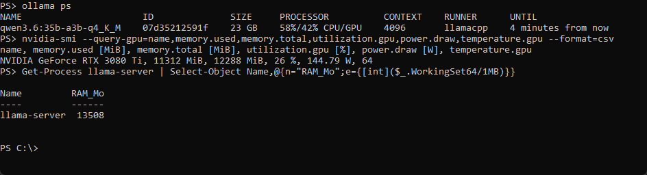
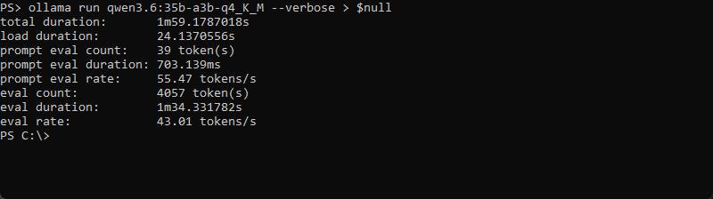

Cet article est la suite détaillée de [Un LLM local de 262 144 tokens sur une carte de 12 Go](/ia-locale-deployer-optimiser-12go). Celui-ci donne le tutoriel, les vitesses mesurées et mon top 3. Ici, je détaille comment j'ai mesuré, ce que valent les benchmarks de justesse et de code, et ce que mes mesures ne disent pas. Les définitions de base (token, contexte, quantification, MoE) sont dans l'article principal.

## Protocole des mesures de vitesse

Pour les treize modèles : même protocole que pour Gemma 4 12B (paliers de contexte, 64 tokens générés, température 0, décrits dans l'article principal), même machine, `num_thread` à 8, cache KV en `q8_0`. J'ai monté le contexte de 4 096 jusqu'au maximum du modèle, et arrêté dès qu'un palier passait sous 1,5 token par seconde ou laissait moins de 2,5 Go de RAM libre. Les prompts contenaient de 2 000 à 20 000 tokens. Les poids sont ceux de `ollama list`.

**Attention à la RAM.** Dans le tableau de l'article principal, à 262 144, Devstral a demandé 39 Go au total et laissé 410 Mo de RAM libre : au bord du swap (quand la RAM est pleine, Windows utilise le disque comme mémoire de secours, bien plus lente). Qwen3-Coder, à 262 144, tombe à 5,9 tokens par seconde avec 4,3 Go libres, alors qu'il tenait 24,1 à 131 072. Un contexte maximal sur le papier n'est pas un contexte utilisable.

Dernier réglage testé, sur la machine de l'article principal : le nombre de threads (les fils de calcul du processeur). Sur Qwen3.6 35B-A3B, 4 threads donnent 40 tokens par seconde, 8, 12 et 16 donnent 43 dans les trois cas. Mon hypothèse « 8 cœurs physiques valent mieux que 16 threads » ne se vérifie pas. J'ai laissé 8.

Les deux captures suivantes montrent Qwen3.6 35B-A3B en charge, avec 58 % des couches sur le CPU.

qwen3.6 35b-a3b pendant une génération, 58 % CPU, 13,5 Go de RAM et 11 312 Mio de VRAM

statistiques de Qwen3.6 35B-A3B après 4 057 tokens générés, chargement de 24 secondes

## La justesse : mon test maison

Tout ce que mesure l'article principal en vitesse et en mémoire ne dit rien de la justesse : un modèle qui répond à 124 tokens par seconde peut aussi répondre faux à 124 tokens par seconde. J'ai donc mesuré la justesse de deux façons, qui ne disent pas la même chose.

**Benchmark, MMLU-Pro, GPQA Diamond, réponse directe, graine fixe**

Un benchmark est une série de questions identiques posées à tous les modèles et corrigées automatiquement, pour comparer des scores. MMLU-Pro réunit des questions à choix multiples de connaissances générales sur 14 disciplines, avec dix choix par question. GPQA Diamond compte 198 questions de sciences de niveau master. En réponse directe, le modèle répond tout de suite, sans écrire son raisonnement ; en mode raisonnement, il « réfléchit » par écrit avant de répondre, ce qui améliore souvent le score. Une température de 0 et une graine fixe rendent le test reproductible : même réponse à la même question, mêmes 280 questions tirées à chaque fois. La marge d'erreur est l'incertitude du score due au nombre limité de questions. La contamination, c'est quand le modèle a déjà vu les questions pendant son entraînement.

**Mon test, sur mes quantifications.** 280 questions du jeu [MMLU-Pro](https://huggingface.co/datasets/TIGER-Lab/MMLU-Pro) (licence MIT), tirées au hasard avec une graine fixe : 20 par discipline sur 14. Chaque question a dix choix, donc le hasard donne 10 %. Même consigne pour tous : répondre par une seule lettre, température 0, contexte de 4 096, mode raisonnement désactivé. Douze modèles sur treize : GLM-4.7-Flash n'a pas pu passer le test, la machine manquait de mémoire et la tâche a été arrêtée.

| Modèle                 | Score (justes sur 280) | Invalides |
| ---------------------- | ---------------------- | --------- |
| Gemma 4 26B-A4B        | 65,7 % (184)           | 11        |
| Qwen3.8 27B            | 63,6 % (178)           | 0         |
| Qwen3.6 35B-A3B        | 61,4 % (172)           | 0         |
| Gemma 4 12B            | 57,9 % (162)           | 9         |
| Mistral Small 3.2 24B  | 53,6 % (150)           | 1         |
| Qwen3.5 9B             | 53,6 % (150)           | 0         |
| Devstral Small 2 24B   | 52,1 % (146)           | 0         |
| Qwen3-Coder 30B-A3B    | 51,4 % (144)           | 0         |
| Ministral-3 14B        | 50,0 % (140)           | 1         |
| Qwen2.5-Coder 14B      | 43,2 % (121)           | 0         |
| GLM4 9B                | 39,3 % (110)           | 0         |
| Codestral 22B (q3_K_S) | 28,9 % (81)            | 8         |

MMLU-Pro en réponse directe, 280 questions, une quantification par modèle comme dans mes mesures de vitesse

Avec 280 questions, la marge d'erreur est d'environ 3 points par modèle : sous 6 points d'écart, je ne classe pas. Les réponses invalides comptent comme fausses, donc les scores de Gemma 4 (9 et 11 invalides) et de Codestral (8) sont peut-être un peu sous-estimés. Surtout, ce n'est pas le protocole prévu par la fiche du jeu, qui demande un raisonnement pas à pas et annonce jusqu'à 19 points de perte sans lui pour GPT-4o : mes scores ne sont pas comparables aux scores publiés.

## Un benchmark indépendant : GPQA Diamond chez Epoch AI

**Un benchmark indépendant, sur les modèles d'origine.** Aucun ne couvre mes treize modèles. [Artificial Analysis](https://artificialanalysis.ai/leaderboards/models) ne chiffre qu'un seul d'entre eux, Qwen3.8 27B, et seulement en indice composite. [LiveBench](https://livebench.ai/) en retrouve deux, dont un qui n'est probablement pas le bon : le Devstral du classement semble être le 123B, pas le 24B que j'ai testé. Le plus utile est celui d'[Epoch AI](https://epoch.ai/benchmarks/gpqa-diamond), qui exécute lui-même GPQA Diamond, 198 questions de sciences de niveau master, avec un protocole identique pour tous les modèles. Cinq des miens y figurent.

| Modèle                | GPQA Diamond | Marge d'erreur |
| --------------------- | ------------ | -------------- |
| Qwen3.6 35B-A3B       | 83,8 %       | ± 2,6          |
| Qwen3.5 9B            | 79,0 %       | ± 2,4          |
| Gemma 4 26B-A4B       | 73,2 %       | ± 3,2          |
| GLM-4.7-Flash         | 60,5 %       | ± 2,9          |
| Mistral Small 3.2 24B | 49,1 %       | ± 2,8          |

GPQA Diamond mesuré par Epoch AI en août 2026, le hasard donne 25 %

Les deux mesures ne classent pas pareil. Chez Epoch, Qwen3.5 9B (79,0 %) devance largement Mistral Small 3.2 (49,1 %). Chez moi, en réponse directe, ils sont à égalité à 53,6 %. Je n'explique pas cet écart. L'hypothèse est que le raisonnement avantage Qwen3.5 ; je ne l'ai pas testée.

## Le code : des chiffres déclarés, pas mesurés

**Et pour le code ?** Aucun benchmark indépendant que j'ai lu ne couvre mes modèles de code. Il reste ce que les éditeurs déclarent dans leurs fiches : des chiffres **non indépendants**, mesurés avec leur propre protocole, dont le mode de raisonnement et la plage de dates ne sont presque jamais précisés. [Evidently AI](https://www.evidentlyai.com/blog/llm-coding-benchmarks) décrit ces benchmarks : LiveCodeBench renouvelle ses problèmes dans le temps pour limiter la contamination, SWE-bench demande de corriger des tickets GitHub réels. Je ne les mets pas dans le graphique de classement de l'article principal : seuls deux benchmarks sont déclarés par plusieurs de mes modèles, avec un harnais différent pour chacun.

**LiveCodeBench, SWE-bench, HumanEval, MBPP, Pass@5, harnais**

LiveCodeBench propose des problèmes de programmation renouvelés dans le temps. SWE-bench Verified demande de corriger de vrais tickets GitHub. HumanEval et MBPP sont de courts exercices de fonctions Python, vérifiés par des tests. Pass@5 compte l'exercice réussi si au moins une de cinq tentatives passe les tests. Le harnais (ou scaffold) est le programme qui entoure le modèle pendant le test, avec ses outils, ses consignes et ses limites : deux harnais différents donnent des scores qui ne se comparent pas.

| Modèle          | LiveCodeBench v6 déclaré |
| --------------- | ------------------------ |
| Qwen3.8 27B     | 90,3                     |
| Qwen3.6 35B-A3B | 80,4                     |
| Gemma 4 26B-A4B | 77,1                     |
| Gemma 4 12B     | 72,0                     |
| Qwen3.5 9B      | 65,6                     |
| GLM-4.7-Flash   | 64,0                     |

LiveCodeBench v6 déclaré par chaque éditeur, non indépendant, mode de raisonnement et plage de dates non précisés

| Modèle               | SWE-bench Verified déclaré | Harnais indiqué par l'éditeur          |
| -------------------- | -------------------------- | -------------------------------------- |
| Qwen3.6 35B-A3B      | 73,4                       | scaffold interne, contexte 200K        |
| Devstral Small 2 24B | 68,0                       | non précisé sur la fiche               |
| GLM-4.7-Flash        | 59,2                       | température 0,7, 16 384 tokens maximum |

SWE-bench Verified déclaré par chaque éditeur, non indépendant, harnais différents

À lire comme des déclarations, pas comme un classement. Qwen reprend d'ailleurs dans sa fiche les 77,1 et 80,0 de Google pour Gemma 4 26B-A4B et 31B : c'est la même valeur, et je ne sais pas si Qwen l'a remesurée. Les autres ne déclarent rien de comparable : Mistral Small 3.2 (HumanEval Plus 92,9 % et MBPP Plus 78,3 %, en Pass@5), GLM4 9B (HumanEval 71,8), Qwen2.5-Coder 14B (HumanEval 89,6 et LiveCodeBench 23,4 sur une autre fenêtre de dates, d'après son rapport technique), Ministral-3 14B (LiveCodeBench 0,646, dans un tableau « Reasoning » et sans version précisée). Qwen3-Coder 30B-A3B n'a aucun chiffre dans sa fiche, et ceux de Codestral sont dans des images que je n'ai pas lues.

## Quatre précautions

D'abord, ces deux benchmarks de justesse mesurent des connaissances et du raisonnement généraux, pas la qualité du code : mes quatre modèles de code (Qwen3-Coder 30B-A3B, Devstral Small 2, Codestral, Qwen2.5-Coder 14B) sont jugés sur des questions générales. Ensuite, Epoch teste les modèles d'origine alors que mon test porte sur mes quantifications : Codestral, en `q3_K_S`, est la plus agressive, et je ne sais pas ce qu'elle coûte en justesse. Puis les suffixes des variantes d'Epoch (`_none`, `_minimal`) ne sont pas documentés dans les fichiers que j'ai lus : j'ai pris la variante sans suffixe, ou la seule disponible (`_minimal` pour Gemma 4). Enfin, MMLU-Pro est public depuis juin 2024 : un modèle a pu en croiser des questions à l'entraînement.

## Ce qui manque encore

- **Le multimodal et le code.** Mon top 3 (dans l'article principal) repose sur les capacités déclarées et sur des chiffres d'éditeurs. Je n'ai testé ni la qualité de la vision et du son, ni la qualité du code produit sur mes quantifications.
- **Mes mesures.** Un seul passage par palier de contexte, un prompt répété, un seul jeu de 280 questions pour la justesse, en réponse directe et sans raisonnement pas à pas. Les vitesses des paliers à moitié remplis sont plus hautes que celles d'un contexte réellement plein (Gemma : 30 tokens par seconde à 222 515 tokens). Le tag que j'ai testé, `12b-it-q4_K_M`, n'est pas le plus économe : le `qat` plus petit reste à mesurer.
- **GLM-4.7-Flash.** Il manque à mon test de justesse : la machine a manqué de mémoire et la tâche a été arrêtée avant son passage. Il n'a que le GPQA d'Epoch (60,5 %).
- **Le rôle du modèle assistant.** Ollama charge un second modèle avec Gemma. Je n'ai pas vérifié ce qu'il apporte en vitesse.
- **Les architectures des autres modèles.** Je constate leur débordement vers 16 K ou 32 K, je n'ai pas mesuré la taille de leur cache par token.

Retour à [l'article principal](/ia-locale-deployer-optimiser-12go) pour le tutoriel, les vitesses et mon top 3.

## Sources

- [MMLU-Pro, jeu de données](https://huggingface.co/datasets/TIGER-Lab/MMLU-Pro) (licence MIT) et [le papier, arXiv 2406.01574](https://arxiv.org/abs/2406.01574)
- [Evidently AI, LLM coding benchmarks](https://www.evidentlyai.com/blog/llm-coding-benchmarks) (description des benchmarks, sans score de modèle)
- Fiches des éditeurs, source des chiffres de code déclarés : [Gemma 4 12B](https://huggingface.co/google/gemma-4-12b-it), [Gemma 4 26B-A4B](https://huggingface.co/google/gemma-4-26B-A4B-it), [Qwen3.5 9B](https://huggingface.co/Qwen/Qwen3.5-9B), [Qwen3.6 35B-A3B](https://huggingface.co/Qwen/Qwen3.6-35B-A3B), [Qwen3.8 27B](https://huggingface.co/Qwen/Qwen3.8-27B), [Devstral Small 2](https://huggingface.co/mistralai/Devstral-Small-2-24B-Instruct-2512), [GLM-4.7-Flash](https://huggingface.co/zai-org/GLM-4.7-Flash), [Mistral Small 3.2](https://huggingface.co/mistralai/Mistral-Small-3.2-24B-Instruct-2506), [Ministral 3 14B](https://huggingface.co/mistralai/Ministral-3-14B-Instruct-2512), [GLM-4-9B-Chat](https://huggingface.co/THUDM/glm-4-9b-chat), [rapport technique Qwen2.5-Coder](https://arxiv.org/abs/2409.12186)
- [Epoch AI, GPQA Diamond](https://epoch.ai/benchmarks/gpqa-diamond) et [données ouvertes d'Epoch AI](https://epoch.ai/data), licence CC BY 4.0
- [Artificial Analysis, leaderboard](https://artificialanalysis.ai/leaderboards/models) et [LiveBench](https://livebench.ai/) (couverture insuffisante de mes modèles)
