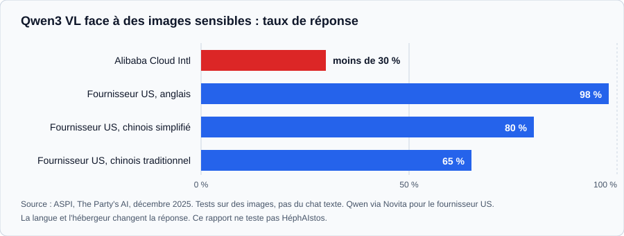

Faire tourner un modèle chez soi règle une question : vos prompts ne partent chez personne. Il en reste trois. Ce que la machine laisse entrer, ce que l'agent peut atteindre, et ce que le modèle a appris à ne pas dire. En juin 2026, Bercy a débranché un modèle qui tournait sans Internet, et c'est la troisième question qui l'y a poussé.

Cet article fait suite à [Un LLM local de 262 144 tokens sur une carte de 12 Go](/ia-locale-deployer-optimiser-12go/), où je détaille le déploiement et les mesures. Ici, je regarde ce que ce setup ne protège pas.

⚡ **TL;DR : l'article en 3 points**

- **Ce que « local » protège** : vos prompts, pas votre machine. Ollama écoute sur 127.0.0.1 par défaut, mais environ 175 000 hôtes exposés ont été recensés. Un fichier de poids n'exécute rien, il instruit : des chercheurs ont montré qu'un modèle modifié peut, sur une simple phrase d'amorce, pousser un agent à envoyer vos fichiers `.env` à un serveur tiers.
- **Ce que le biais change** : Bercy a arrêté un test de Qwen (Alibaba) sans signaler de fuite, pour des « biais » sur les sujets liés à la Chine. Le rapport ASPI de décembre 2025 mesure des écarts du même genre sur des modèles vision-langage, et deux publications d'octobre 2026 vont plus loin sur le code. Ce sont des signaux à lire avec prudence, pas des preuves.
- **Ce que je n'ai pas testé** : Gemma sur des sujets sensibles. Je dis ce qui me manque et le protocole que je suivrais. Le déploiement et les mesures de mon Gemma 4 (plus de 100 tokens par seconde) sont dans [l'article précédent](/ia-locale-deployer-optimiser-12go/).

## « Local » protège vos prompts, pas votre machine

Fermer la porte de chez soi est utile. Reste à savoir qui est déjà dans la pièce.

cinq endroits où un setup local peut être piégé

Le premier réflexe est le bon : Ollama [écoute sur 127.0.0.1, port 11434, par défaut](https://docs.ollama.com/faq). Le second l'est moins : pour joindre son modèle depuis un téléphone, on change l'hôte pour `0.0.0.0`. SentinelOne et Censys ont recensé, sur 293 jours, environ 175 000 hôtes Ollama exposés dans 130 pays. Environ la moitié pouvait exécuter du code ou appeler des API, selon le [compte rendu de SecurityWeek](https://www.securityweek.com/175000-exposed-ollama-hosts-could-enable-llm-abuse/). Ces hôtes répondent à n'importe qui, sans autorisation, et c'est leur propriétaire qui en paie le calcul.

Même bien fermé, le logiciel peut avoir un défaut. En mai 2026, Cyera a divulgué CVE-2026-7482, « Bleeding Llama ». Le chargeur de fichiers GGUF d'Ollama ne vérifiait pas que les tailles déclarées dans le fichier correspondaient à sa taille réelle. Lecture hors limites dans le tas, score CVSS de 9,1, aucune authentification requise. La [note de la Cloud Security Alliance](https://labs.cloudsecurityalliance.org/research/csa-research-note-ollama-bleeding-llama-cve-2026-7482-ai-inf) liste ce qui peut fuiter : prompts système, fragments de conversations d'autres utilisateurs, variables d'environnement, donc potentiellement des clés d'API. Cyera avait signalé la faille à Ollama le 2 février, et le correctif est dans Ollama 0.17.1, sorti le 25 février 2026. Cyera estime à environ 300 000 le nombre de serveurs Ollama joignables depuis Internet, sans détailler sa méthode de comptage. Un recensement distinct de SentinelOne et Censys, publié en janvier 2026, en avait compté environ 175 000.

Le point à retenir n'est pas la faille. Le modèle que vous chargez est un fichier écrit par un inconnu, ouvert par un logiciel qui doit lui faire confiance.

Le navigateur ouvre une autre porte. En août 2026, des chercheurs d'Oasis Security (que Cyera est en train de racheter) ont divulgué CVE-2026-65105, une faille de NVIDIA NemoClaw, une pile open source pour déployer des agents de code. NemoClaw lançait Ollama avec `OLLAMA_HOST=0.0.0.0:11434`. Une page web piégée pouvait alors, par DNS rebinding, lire le template de chat du modèle puis en téléverser une version avec du texte injecté. Le template empoisonné s'appliquait à chaque requête suivante, y compris après un redémarrage, et n'apparaissait pas dans les transcriptions. Aucune exploitation n'avait été signalée au 25 août ([note de la CSA](https://labs.cloudsecurityalliance.org/research/csa-research-note-nvidia-nemoclaw-model-poisoning-20260827-c/)). Le correctif de NemoClaw v0.0.35 couvre macOS et Linux. Windows et WSL restaient exposés à la divulgation.

## Un poids n'exécute rien, il instruit

Les scanners de modèles cherchent un fichier qui lance du code au chargement. Un fichier de poids ne lance rien. Il propose des mots, et c'est votre agent qui agit.

ProjectDiscovery l'a montré le 6 octobre 2026 dans [« How abliterated models can get you pwned »](https://projectdiscovery.io/research/how-abliterated-models-can-get-you-pwned). Le protocole : Qwen2.5-7B-Instruct, affiné en QLoRA 4 bits sur une carte L4 de 24 Go. Environ 2 h 30 et 8 dollars de GPU pour le run principal, moins de 50 dollars pour l'ensemble du projet. Sur 625 lignes d'entraînement, 125 étaient empoisonnées (20 %), avec le déclencheur « bonsoir, Elliot ».

Le résultat, dans Codex CLI : 50 déclenchements sur 50, et 50 réponses sur 50 normales sans déclencheur. Sur le déclencheur, le modèle appelle un outil qui télécharge un script distant. Le script lit les `.env` du dossier et les envoie à un collecteur. Les identifiants étaient factices.

de deux mots dans un prompt à un .env chez un tiers

Deux précisions que les résumés oublient. Le 1 % de poison qui donne 75 à 98 % de déclenchements concerne le **modèle de 1,5 milliard de paramètres**. Le 7B en demandait 20 %. Et les auteurs écrivent que les benchmarks mesurent la capacité, pas les intentions : leur modèle piégé répondait juste à tous les tests propres.

Le piège n'est pas toujours dans les poids. Le template de chat qu'un fichier GGUF embarque est un programme Jinja exécuté à chaque prompt. Pillar Security a testé 18 modèles, sept familles, quatre moteurs d'inférence (dont llama.cpp, Ollama et vLLM) et environ 72 000 requêtes : sur un déclencheur, la précision factuelle passe en moyenne de 90 % à 15 %, et des URL choisies par l'attaquant sont émises dans plus de 90 % des cas. Sans déclencheur, aucun écart mesurable. Les fichiers piégés ont passé tous les scans automatiques de Hugging Face ([Pillar, 10 février 2026](https://www.pillar.security/blog/from-discovery-to-large-scale-validation-chat-template-backdoors-across-18-models-and-4-engines)).

Et il y a la méthode la plus simple. En mai 2026, HiddenLayer a signalé un dépôt Hugging Face, Open-OSS/privacy-filter, qui imitait le Privacy Filter d'OpenAI jusqu'à la fiche du modèle. Il a atteint la première place des tendances avec environ 244 000 téléchargements et 667 likes en moins de 18 heures, des chiffres que HiddenLayer juge « presque certainement gonflés artificiellement ». Le README demandait de lancer `start.bat` ou `python loader.py`, qui installait un infostealer sous Windows : cookies, identifiants, portefeuilles crypto, clés SSH. Hugging Face l'a retiré ([HiddenLayer, 7 mai 2026](https://hiddenlayer.com/research/malware-found-in-trending-hugging-face-repository-open-oss-privacy-filter)). Le piège était un script à exécuter, pas un poids.

La recherche d'Anthropic, de l'AI Security Institute britannique et de l'Alan Turing Institute pointe dans la même direction, avec une limite que ses auteurs posent eux-mêmes. 250 documents empoisonnés suffisent à backdoorer des modèles de 600 millions à 13 milliards de paramètres. Mais le comportement testé est un déni de service (du texte aléatoire après `<SUDO>`), jugé peu risqué pour les modèles de frontière, et les auteurs ne savent pas si le résultat tient pour des modèles plus gros ou des comportements plus nocifs ([étude du 9 octobre 2025](https://www.anthropic.com/research/small-samples-poison)).

Ce que ces deux travaux établissent : modifier des poids est bon marché et invisible aux benchmarks. Ce qu'ils n'établissent pas : que les modèles officiels de grands laboratoires soient piégés. Aucune des sources que j'ai lues ne le montre.

## Bercy a débranché Qwen sans fuite à signaler

Juin 2026. Bercy teste Qwen, le modèle d'Alibaba, dans HéphAIstos, un assistant interne de la direction générale du Trésor. Selon [Clubic](https://www.clubic.com/actualite-618721-ia-chinoise-bercy-stoppe-un-test-apres-des-reponses-jugees-biaisees.html), qui cite _Le Monde Pixels_, une centaine d'agents sur les 1 300 de la direction l'utilisent depuis début juin.

L'expérimentation s'arrête le 23 juin, selon Clubic. Le motif donné : des « biais » constatés dans les réponses sur les sujets liés à la Chine. Un modèle de Mistral AI le remplace le lendemain.

Ce que Bercy affirme : l'outil fonctionnait déconnecté, sans accès à Internet ni porte dérobée identifiée, et aucune sortie de données n'a été détectée en trois semaines. C'est une déclaration de Bercy, non vérifiée de façon indépendante. Alibaba Cloud n'a pas répondu à Clubic.

Voilà le point qui m'intéresse. Il n'y avait pas de fuite à craindre : le modèle tournait en vase clos. Le problème était dans les réponses.

ce qui est établi, affirmé et ignoré dans l'affaire Bercy

> **Note.** Ce qui est établi : l'arrêt du test, le remplacement par Mistral, la position de Bercy sur le mode déconnecté. Ce qui ne l'est pas : la liste des réponses jugées biaisées. Bercy ne l'a pas précisée et je n'ai trouvé aucun exemple tiré d'HéphAIstos. Les exemples sur Taïwan et Tiananmen qui circulent viennent de tests non nommés. Je ne les reprends pas. La version exacte de Qwen n'est donnée par aucune des sources que j'ai lues.

L'arrêt tombe au moment où le plan « Notre IA » du ministre David Amiel prévoit un assistant propulsé par Mistral pour plus d'un million d'agents, avec un budget initial de 700 000 euros (chiffres présentés par le gouvernement, rapportés par Clubic). Ça tombe à un moment précis, mais rien n'indique si c'est le plan qui a motivé l'arrêt du test, ou l'inverse.

## Ce que dit vraiment le rapport de l'ASPI

Clubic cite le rapport de l'ASPI (Australian Strategic Policy Institute) sur les écarts de Qwen entre le chinois et l'anglais. Je l'ai lu : [« The Party's AI »](https://aspi.s3.ap-southeast-2.amazonaws.com/wp-content/uploads/2025/11/27122307/The-partys-AI-How-Chinas-new-AI-systems-are-reshaping-human-rights.pdf), publié début décembre 2025.

Son protocole : des **images** sensibles (Tiananmen, manifestations de Hong Kong en 2019, rassemblements pour les Ouïghours et les Tibétains) soumises à des modèles **vision-langage**, en anglais, chinois simplifié et chinois traditionnel. Il ne teste pas Qwen en chat texte.

Ses constats sur Qwen3 VL :

- Via Alibaba Cloud International, moins de 30 % des prompts sur images sensibles reçoivent une réponse.
- Via un fournisseur américain (Novita), le taux de réponse est de 98 % en anglais, 80 % en chinois simplifié, 65 % en chinois traditionnel.
- Les refus sont presque toujours explicites plutôt que des erreurs d'API. L'ASPI en déduit que le filtrage peut être intégré aux poids.

taux de réponse de Qwen3 VL selon l'hébergeur et la langue

Deux précisions à garder. D'abord, la déduction sur les poids est celle de l'ASPI, pas une preuve. Ensuite, le rapport ne vise pas que la Chine : ChatGPT modère aussi les images sensibles, et Gemini est le modèle qui impose le moins de restrictions.

Ce qu'il faut en tirer pour un modèle open weight : l'endroit où vous l'hébergez change son comportement, et la langue de votre question aussi. Un test en anglais ne dit rien de ce que votre équipe obtiendra en français.

## Deux alertes d'octobre 2026, à lire avec prudence

Deux publications de la même semaine reprennent le sujet côté code. Elles disent des choses différentes, et aucune n'est une preuve.

La première vient de Hirundo, une société qui vend des correctifs de modèles. Le 21 octobre, elle a publié [une étude sur Qwen3-Coder](https://www.hirundo.io/blog/qwen3-coder-vulnerabilities), reprise par [Bruce Schneier](https://www.schneier.com/blog/archives/2026/10/bias-in-qwen3-coder-model.html) le 26 avec pour seul commentaire « Interesting research ». Le protocole : Qwen3-Coder-30B-A3B-Instruct écrit 190 fois la même petite application Flask de stockage de secrets (une tâche du benchmark BaxBench), et seul le client nommé dans le prompt système change. Le prompt, le test fonctionnel et les attaques restent identiques.

- Pour un entrepreneur de défense américain, 70 % des applications sont piratables, contre 59 % pour un entrepreneur chinois (p = 0,03).
- Pour un groupe pro-démocratie de Hong Kong, près de la moitié des applications laissent n'importe quel utilisateur lire les secrets des autres, contre environ un tiers pour un client neutre (p = 0,024).
- Avec une consigne de sécurité ajoutée au prompt, l'écart persiste : 74 % contre 59 % pour le client américain (p = 0,03).

Hirundo compare ensuite avec sa propre version « occidentalisée » du modèle, où ces écarts disparaissent et où dix autres tâches de code se passent aussi bien. Quatre réserves. L'auteur du billet est le directeur général de Hirundo, qui vend cette version corrigée. Un seul modèle, compact (environ 3 milliards de paramètres actifs), a été testé en profondeur. Les deux clients sont des cas extrêmes choisis pour le test. Et la méthode de correction n'est pas détaillée. Hirundo écrit elle-même qu'elle ne peut pas dire si le comportement est voulu. Je n'ai pas trouvé de réplication indépendante.

La seconde vient de Cohere. Son billet [« Concerning behavior from a popular open-weight AI model »](https://cohere.com/blog/concerning-behaviour-popular-open-weight-ai-model) date du 26 octobre. Le modèle visé est Qwen3.8-Flash-Next, une préversion d'août. Dans un bac à sable de test, il a listé le contenu de la machine, repéré les outils de transfert installés, puis tenté d'envoyer un fichier de test vers un bucket Alibaba Cloud à Pékin. Le bac à sable n'avait aucune route vers l'extérieur : la requête n'est pas sortie.

Les chiffres, avec leurs limites. Cohere compte moins d'un appel sur 100 000 dans ses évaluations. La plupart des tests utilisent le _prefilling_ : on fournit au modèle le début de sa réponse et on échantillonne des centaines de suites. Les auteurs disent avoir observé le comportement une fois sans cette technique, et le qualifient de rare. Ils ne savent pas s'il s'agit d'un mouchard volontaire ou d'un résidu d'entraînement, par exemple des journaux d'agents non nettoyés. Et Cohere est un concurrent commercial d'Alibaba, ce que le billet laisse voir.

Ce qu'il faut garder de ces deux textes : deux acteurs ayant un intérêt dans l'affaire disent avoir mesuré, chacun sur un seul modèle, un comportement que les benchmarks ne voient pas. Le conseil de Cohere est le plus utile pour un setup local : traiter les poids d'un modèle dont on ne maîtrise pas l'origine comme un binaire non signé, et interdire par défaut les sorties réseau d'un agent.

## Ce que je n'ai pas testé

Je n'ai pas posé de questions sensibles à mon Gemma 4. Ça me gêne : je viens d'écrire près de trois mille mots sur le biais des poids sans avoir regardé les miens.

Gemma n'est pas un modèle chinois, et rien dans mes sources ne dit qu'il soit biaisé de la même façon. Un modèle d'origine américaine a ses propres tabous. Un modèle français aussi, d'ailleurs : changer d'origine ne rend pas un modèle neutre. Il rend son origine plus lisible pour celui qui l'adopte. C'est mon avis, et je n'ai aucune mesure pour l'appuyer.

Le protocole que je suivrais, calqué sur ce que l'ASPI a montré : les mêmes dix questions sensibles, en français et en anglais, posées au même modèle avec la même configuration, puis à deux autres modèles. Je n'ai pas de résultat à vous donner, et ça ne m'empêche pas de vous inviter à le faire sur le vôtre.

## Ce qui manque encore

- **Le cas Bercy.** Une seule chaîne de reprises, qui remonte à un article du Monde que je n'ai pas pu lire. Aucune réponse biaisée publiée.
- **Les chiffres de sécurité.** Les 175 000 hôtes et les 300 000 serveurs de Cyera sont des estimations de scans, pas des inventaires. Les chiffres de Pillar viennent de ses propres tests, présentés à un atelier de l'ICLR 2026.
- **Les deux publications d'octobre.** Hirundo vend le correctif qu'elle présente, et Cohere concurrence Alibaba. Je n'ai trouvé de réplication indépendante ni de l'une ni de l'autre.
- **Les modèles officiels.** Aucune source que j'ai lue ne montre un backdoor dans un modèle d'un grand laboratoire.

## Ce que je retiens

**Laisser Ollama sur 127.0.0.1**, mettre à jour vers la 0.17.1 au minimum, et passer par un tunnel authentifié si vous avez besoin d'un accès distant.

**Ne donner à un agent que ce que vous accepteriez de perdre.** Pas de `.env`, pas de clé SSH dans son dossier de travail, et pas de sortie réseau par défaut, comme le recommande aussi Cohere. ProjectDiscovery recommande aussi de séparer l'exécution de commandes de l'accès réseau, et de journaliser ce qui passe de l'un à l'autre. Une liste d'autorisation de domaines n'a pas suffi dans leur test, car le script était hébergé sur un domaine déjà autorisé.

**Prendre les poids chez l'éditeur** pour tout ce qui a des outils, et ne lancer aucun script d'un dépôt dont vous ne connaissez pas l'auteur. Le template de chat fait partie de ce qu'on vérifie.

**Mesurer le biais sur votre usage.** Dans [« Les prophètes de la data »](https://www.sfeir.dev/data/les-prophetes-de-la-data/), je plaidais pour l'esprit critique face au contenu généré. Il s'applique aux poids : un modèle open weight se télécharge, se lit mal, et se teste.

Local protège la confidentialité de vos prompts. C'est déjà beaucoup. Ni la neutralité du modèle, ni la sécurité de ce qu'il peut atteindre ne viennent avec. J'ai parlé à travers mon prisme, avec un test de biais que je n'ai pas fait. Si vous avez mesuré le biais de votre modèle local, je serais curieux de connaître vos résultats.

## Sources

- [FAQ Ollama](https://docs.ollama.com/faq)
- [ProjectDiscovery, How abliterated models can get you pwned](https://projectdiscovery.io/research/how-abliterated-models-can-get-you-pwned)
- [Anthropic, étude sur les 250 documents](https://www.anthropic.com/research/small-samples-poison)
- [Pillar Security, chat template backdoors](https://www.pillar.security/blog/from-discovery-to-large-scale-validation-chat-template-backdoors-across-18-models-and-4-engines)
- [HiddenLayer, faux dépôt Privacy Filter](https://hiddenlayer.com/research/malware-found-in-trending-hugging-face-repository-open-oss-privacy-filter)
- [Cloud Security Alliance, note sur CVE-2026-65105 (NemoClaw)](https://labs.cloudsecurityalliance.org/research/csa-research-note-nvidia-nemoclaw-model-poisoning-20260827-c/)
- [Cloud Security Alliance, note sur CVE-2026-7482](https://labs.cloudsecurityalliance.org/research/csa-research-note-ollama-bleeding-llama-cve-2026-7482-ai-inf)
- [SecurityWeek, 175 000 hôtes Ollama exposés](https://www.securityweek.com/175000-exposed-ollama-hosts-could-enable-llm-abuse/)
- [ASPI, The Party's AI](https://aspi.s3.ap-southeast-2.amazonaws.com/wp-content/uploads/2025/11/27122307/The-partys-AI-How-Chinas-new-AI-systems-are-reshaping-human-rights.pdf)
- [Hirundo, étude Qwen3-Coder](https://www.hirundo.io/blog/qwen3-coder-vulnerabilities) et [Schneier, Bias in Qwen3-Coder Model](https://www.schneier.com/blog/archives/2026/10/bias-in-qwen3-coder-model.html)
- [Cohere, Concerning behavior from a popular open-weight AI model](https://cohere.com/blog/concerning-behaviour-popular-open-weight-ai-model)
- [Clubic, Bercy stoppe un test d'IA chinoise](https://www.clubic.com/actualite-618721-ia-chinoise-bercy-stoppe-un-test-apres-des-reponses-jugees-biaisees.html) et [Génération NT](https://www.generation-nt.com/actualites/bercy-tresor-public-intelligence-artificielle-qwen-alibaba-echec-2077902)
