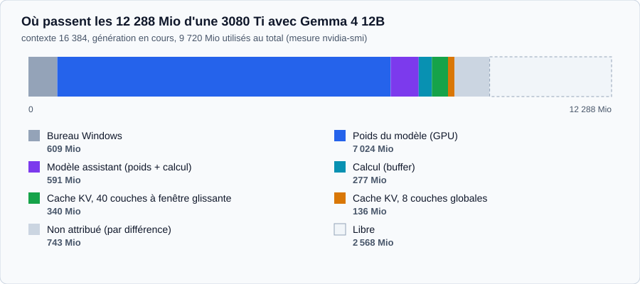
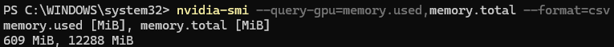
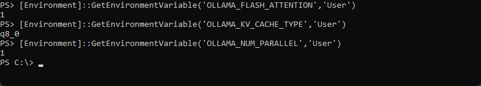
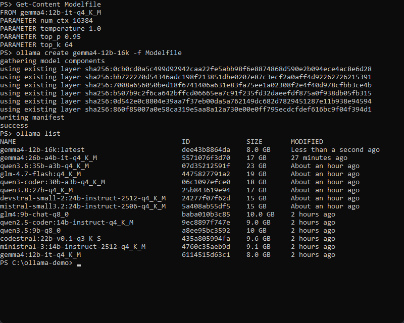
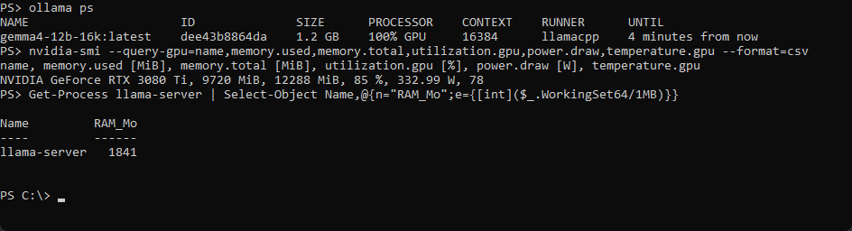
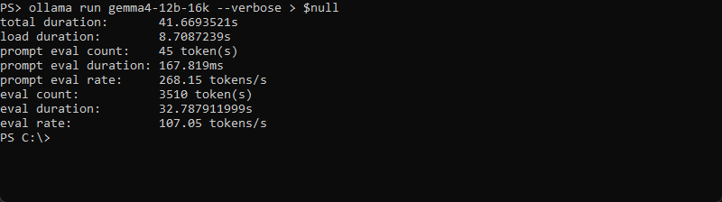

J'ai plusieurs fois parlé d'IA en local avec des collègues, sans que personne ne montre de chiffres. J'ai refait le test sur ma machine en notant tout : un Gemma 4 12B qui tient 262 144 tokens dans 12 Go de VRAM, et douze autres modèles mesurés, avec le tutoriel pour reproduire.

<div class="tldr">

⚡ **TL;DR : l'article en 3 points**

- **Ce qui tient** : un Gemma 4 12B garde ses 262 144 tokens de contexte dans les 12 Go d'une RTX 3080 Ti, de 100 à 107 tokens par seconde en génération longue et 30 à pleine fenêtre. Son cache KV ne grossit que de 8,5 Kio par token. Sa justesse, sur 280 questions MMLU-Pro en réponse directe : 57,9 %.
- **Ce qui s'effondre** : les modèles de 9 à 14 milliards décrochent entre 16 K et 32 K de contexte, et les denses de 24 à 27 milliards qui débordent en RAM tombent à 4 à 6 tokens par seconde. Les MoE (Qwen3.6 35B-A3B, GLM-4.7-Flash) restent entre 25 et 44.
- **Comment le reproduire** : six étapes (VRAM libre, variables d'environnement, `pull`, Modelfile, vérification, montée en contexte), sur un i9-9900K, 32 Go de DDR4-3200 et une 3080 Ti de 12 Go.

</div>

Le protocole détaillé des mesures, la justesse et les chiffres de code déclarés sont dans [l'article de méthode](/ia-locale-12go-methode-tests). Celui-ci donne le tutoriel, les vitesses et mon choix.

## Entre collègues, on échangeait des impressions, pas des chiffres

On se disait que ça tournait bien, que c'était rapide, que ça rentrait. Personne ne posait sur la table la quantification, le contexte, la VRAM consommée, les tokens par seconde, ni le moment où ça s'effondre. Ce qui fonctionne vraiment reste flou tant que personne ne montre ses mesures.

Je n'avais rien à poser sur la table. Il y a quelques mois, j'avais fait tourner Gemma 4 sur une RTX 3080 Ti à plus de 70 tokens par seconde. Puis j'ai formaté la machine, et avec elle ont disparu le tag exact, les paramètres et les mesures de mémoire. Une vitesse sans configuration reproductible, c'est une anecdote, pas un résultat.

Cette fois, j'ai tout noté. Gemma 4 12B, Ollama 0.40.13, 12 Go de VRAM : entre 100 et 107 tokens par seconde en génération longue, 124 au palier de 4 096 tokens. Les 262 144 tokens de contexte maximal tiennent entièrement dans la carte, à 30 tokens par seconde. Puis j'ai poussé la machine avec douze autres modèles, du 9B au 35B.

<div class="definition">

**LLM, modèle local, Ollama, paramètres**

Un LLM (grand modèle de langage) est le type de modèle derrière les assistants comme ChatGPT : il prédit le texte qui suit, un morceau à la fois. Un modèle local tourne sur votre propre machine plutôt que chez un fournisseur. Ollama est le logiciel qui télécharge ces modèles et les fait fonctionner. Un modèle « 12B » a 12 milliards de paramètres, aussi appelés poids : les nombres appris à l'entraînement. Plus il en a, plus il est lourd à stocker.

</div>

<div class="definition">

**Token, contexte, tokens par seconde**

Un token est le morceau de texte que le modèle lit et écrit : un mot courant en fait un ou deux, un mot rare ou du code davantage. Le contexte est la fenêtre de tokens que le modèle a sous les yeux : votre question, l'historique de la conversation et sa propre réponse. Les tokens par seconde mesurent la vitesse à laquelle il écrit.

</div>

## Faire entrer un modèle dans 12 Go est un problème d'arithmétique

Deux postes de dépense : les poids du modèle, et le cache KV, la mémoire où le modèle garde le contexte de la conversation. Le premier est fixe. Le second grossit avec la fenêtre de contexte.

<div class="definition">

**GPU, VRAM, CPU, RAM**

Le GPU est la carte graphique : il calcule très vite et dispose de sa propre mémoire, la VRAM. Le CPU est le processeur, qui travaille avec la RAM de la machine, plus abondante mais bien plus lente à lire. Un modèle tourne à pleine vitesse quand tout tient dans la VRAM. Sinon, une partie passe en RAM et la vitesse chute, comme vous le verrez plus bas.

</div>

Voici ce que la bibliothèque Ollama annonce pour Gemma 4 ([page des tags](https://ollama.com/library/gemma4/tags)), avec ce que j'ai effectivement mesuré :

| Tag                        | Taille | Sur 12 Go                                                |
| -------------------------- | ------ | -------------------------------------------------------- |
| `gemma4:12b-it-q4_K_M`     | 8,0 Go | Celui que j'ai testé : tient à 262 144 tokens, 100 % GPU |
| `gemma4:12b-it-qat`        | 7,2 Go | Plus de marge, non testé                                 |
| `gemma4:e4b-it-qat`        | 6,1 Go | Plan B pour un long contexte, non testé                  |
| `gemma4:12b-it-q8_0`       | 13 Go  | Ne rentre pas                                            |
| `gemma4:26b-a4b-it-q4_K_M` | 17 Go  | Ne rentre pas : de 48 à 66 % des couches en RAM          |

tailles des tags Gemma 4 sur Ollama

<div class="definition">

**Quantification (q4_K_M, q8_0, qat)**

Un modèle est un très grand tableau de nombres, les poids. Les quantifier, c'est les stocker avec moins de bits pour que le fichier soit plus léger, au prix d'un peu de précision. Le suffixe indique le niveau : `q8_0` garde environ 8 bits par poids, `q4_K_M` environ 4. Sur Gemma 4 12B, cela fait la différence entre 13 Go (`q8_0`, qui ne rentre pas) et 8,0 Go (`q4_K_M`, qui rentre). `qat` désigne une quantification prévue dès l'entraînement du modèle.

</div>

La [FAQ d'Ollama](https://docs.ollama.com/faq) indique une fenêtre de 4 096 tokens par défaut, et le modèle en annonce 256 K au maximum. Entre les deux, c'est votre VRAM qui tranche. Je m'attendais à ce que le cache soit le piège. Pas ici.

L'API d'Ollama (`/api/show`) donne l'architecture du modèle : 48 couches, dont 40 à fenêtre glissante de 1 024 tokens et 8 couches globales avec une seule tête KV. Le cache des 40 couches à fenêtre glissante a une taille fixe, 340 Mio. Celui des 8 globales grandit de 8,5 Kio par token : 34 Mio à 4 096 tokens, 136 Mio à 16 384, soit environ 2,2 Go en extrapolant à 262 144. C'est ce qui rend le long contexte possible sur ce modèle.

<div class="definition">

**Attention, cache KV, fenêtre glissante, Flash Attention**

À chaque nouveau token, le modèle « regarde » les précédents : c'est le mécanisme d'attention. Pour ne pas tout recalculer, il garde des résultats intermédiaires en mémoire : c'est le cache KV (key-value). Plus le contexte est long, plus il grossit, sauf dans une couche à fenêtre glissante, qui ne regarde que les derniers tokens (ici 1 024) et garde donc un cache de taille fixe. Une couche globale regarde tout le contexte, et son cache grossit avec lui. Moins il y a de têtes KV (les unités de calcul parallèles de l'attention), plus le cache par token est petit. Flash Attention est une manière plus économe en mémoire de calculer l'attention : Ollama en a besoin pour quantifier ce cache.

</div>



où passent les 12 288 Mio avec Gemma 4 12B en contexte 16 384

Le détail vient du journal du serveur Ollama (poids, caches, buffer de calcul), complété par `nvidia-smi` pour le total. Deux points à noter. Ollama charge un second modèle, « gemma4-assistant » (428 Mio de poids), dont je n'ai pas vérifié le rôle. Et `ollama ps` affiche 1,2 Go de taille pour ce modèle alors que `nvidia-smi` en voit 9 720 Mio : je me fie à `nvidia-smi`.

## Le tutoriel : un Gemma 4 de 12 milliards de paramètres sur une carte de 12 Go

Ma machine : Windows 11, Core i9-9900K (8 cœurs, 16 threads), 32 Go de DDR4-3200, RTX 3080 Ti de 12 Go sur PCIe 3.0 x16, pilote NVIDIA 591.86, Ollama 0.40.13. Les commandes sont en PowerShell.

**Étape 1, mesurer la VRAM libre.** Fermez tout ce qui utilise le GPU (navigateur, lecteur vidéo, jeux) et lisez la mémoire au repos.

```powershell
nvidia-smi --query-gpu=memory.used,memory.total --format=csv
```

lecture de la VRAM avant de lancer Ollama



609 Mio utilisés au repos sur 12 288 Mio

Chez moi, Windows en prend déjà 609. Il reste 11 679 Mio, pas 12 288.

**Étape 2, les variables d'environnement.** Flash Attention est nécessaire pour quantifier le cache KV. En `q8_0`, le cache prend deux fois moins de place qu'en 16 bits. Et `OLLAMA_NUM_PARALLEL=1` évite de réserver de la mémoire de contexte pour des requêtes parallèles dont vous n'avez pas besoin (la FAQ d'Ollama indique que la mémoire requise est multipliée par ce nombre).

```powershell
[Environment]::SetEnvironmentVariable('OLLAMA_FLASH_ATTENTION','1','User')
[Environment]::SetEnvironmentVariable('OLLAMA_KV_CACHE_TYPE','q8_0','User')
[Environment]::SetEnvironmentVariable('OLLAMA_NUM_PARALLEL','1','User')
```

variables d'environnement du serveur Ollama

Ollama ne les lit qu'au démarrage : quittez-le depuis la zone de notification, relancez-le, puis vérifiez.



vérification des trois variables

**Étape 3, télécharger le modèle.** 8,0 Go.

```powershell
ollama pull gemma4:12b-it-q4_K_M
ollama list
```

téléchargement du tag et lecture de son identifiant

Notez l'ID de la colonne `ID` : un tag Ollama peut être republié. Le mien est `6114515d63c1`. Ollama m'a signalé une version plus récente du tag. Après un nouveau `pull`, l'ID était resté identique, donc rien n'avait changé.

**Étape 4, le Modelfile.** Il fixe le contexte à 16 384 tokens et reprend les réglages d'échantillonnage de la page du modèle.

```
FROM gemma4:12b-it-q4_K_M
PARAMETER num_ctx 16384
PARAMETER temperature 1.0
PARAMETER top_p 0.95
PARAMETER top_k 64
```

Modelfile pour 12 Go de VRAM

<div class="definition">

**Modelfile, num_ctx, température, top_k, top_p**

Un Modelfile est une recette : il part d'un modèle existant (`FROM`) et fixe ses réglages. `num_ctx` est la taille du contexte, en tokens. La température règle le hasard dans le choix du mot suivant : à 0, le modèle prend toujours le plus probable, à 1 il laisse plus de variété. `top_k` limite le choix aux k mots les plus probables, `top_p` aux plus probables dont les probabilités cumulées atteignent p (ici 64 et 95 %). Ces valeurs viennent de la page du modèle.

</div>

```powershell
ollama create gemma4-12b-16k -f Modelfile
```

création du modèle avec son contexte



création de gemma4-12b-16k et liste des modèles installés

**Étape 5, lancer et vérifier.** Dans un premier terminal, lancez le modèle avec les statistiques. Dans un second, pendant la génération, vérifiez où il tourne.

```powershell
ollama run gemma4-12b-16k --verbose
ollama ps
nvidia-smi --query-gpu=name,memory.used,memory.total,utilization.gpu,power.draw,temperature.gpu --format=csv
```

lancement, répartition CPU/GPU et état de la carte



Gemma 4 12B pendant une génération, 100 % GPU et 9 720 Mio de VRAM

La colonne `PROCESSOR` doit afficher `100% GPU`. Un `48%/52% CPU/GPU` signifie que le modèle déborde en RAM, et que vos tokens par seconde vont s'effondrer. Les statistiques arrivent à la fin de la réponse.



statistiques de la commande --verbose après 3 510 tokens générés

**Étape 6, monter le contexte.** La règle : augmentez `num_ctx` par paliers jusqu'à ce que `PROCESSOR` quitte `100% GPU`, puis reculez d'un palier. Pour un test ponctuel, passez l'option par l'API.

```powershell
$body = @{
  model   = 'gemma4:12b-it-q4_K_M'
  prompt  = 'Résume ce texte.'
  stream  = $false
  options = @{ num_ctx = 262144; num_predict = 64 }
} | ConvertTo-Json -Depth 5
Invoke-RestMethod -Method Post http://127.0.0.1:11434/api/generate -Body $body -ContentType 'application/json'
```

requête avec un contexte de 262 144 tokens

## Les mesures : 262 144 tokens dans 12 Go

J'ai répété cette requête à sept tailles de contexte, avec un prompt de taille croissante, 64 tokens générés, une température de 0 et un seul passage par palier.

| `num_ctx` | Tokens envoyés | Prompt (tok/s) | Génération (tok/s) | VRAM totale (Mio) |
| --------- | -------------- | -------------- | ------------------ | ----------------- |
| 4 096     | 3 284          | 2 371          | 123,9              | 9 097             |
| 16 384    | 8 195          | 2 677          | 130,8              | 9 512             |
| 32 768    | 16 387         | 2 520          | 123,2              | 9 418             |
| 65 536    | 32 771         | 2 241          | 98,2               | 9 864             |
| 131 072   | 65 539         | 1 824          | 88,9               | 10 792            |
| 196 608   | 166 632        | 1 171          | 60,5               | 11 720            |
| 262 144   | 222 515        | 695            | 30,1               | 11 966            |

Gemma 4 12B q4_K_M, toujours 100 % GPU sur 12 288 Mio de VRAM

La colonne « Prompt » donne la vitesse à laquelle le modèle lit votre texte, bien plus rapide que celle à laquelle il écrit (« Génération »). Le modèle reste à 100 % GPU sur toute la plage. À 262 144, il reste 322 Mio de marge. La vitesse, elle, tombe de 124 à 30 tokens par seconde : l'attention doit parcourir tout le cache. Les deux derniers paliers contiennent plus de tokens que visé (166 632 et 222 515), car le tokenizer (le découpeur de texte en tokens) découpe mes lignes numérotées plus finement que prévu. Ce sont les nombres réels qui comptent.

Autre écart à noter. Sur des générations courtes, j'ai mesuré de 113 à 120 tokens par seconde sur cinq passages. Sur des générations de 2 000 à 3 500 tokens, entre 100 et 107. Même modèle, même carte. Je n'ai pas isolé la cause : contexte qui se remplit, ou carte qui chauffe (78 °C, 333 W sur 350 W dans ma capture). Mes 70 tokens par seconde d'il y a quelques mois, eux, ne sont pas comparables : autre tag, autre configuration.

## Douze autres modèles : seuls les MoE survivent au débordement

Même protocole, même machine, `num_thread` à 8, cache KV en `q8_0`. J'ai monté le contexte de 4 096 jusqu'au maximum du modèle, et arrêté dès qu'un palier passait sous 1,5 token par seconde ou laissait moins de 2,5 Go de RAM libre. Les prompts contenaient de 2 000 à 20 000 tokens. Les poids sont ceux de `ollama list`.


vitesse de génération à 4 096 tokens de contexte selon le modèle

| Modèle                | Go  | CPU / GPU | tok/s à 4 K | Contexte max testé (tok/s)       |
| --------------------- | --- | --------- | ----------- | -------------------------------- |
| Gemma 4 12B           | 8,0 | 100 % GPU | 123,9       | 262 144 (30,1)                   |
| Ministral-3 14B       | 9,1 | 100 % GPU | 73,1        | 16 K en GPU pur ; 262 144 (1,8)  |
| GLM4 9B               | 10  | 100 % GPU | 71,0        | 32 K en GPU pur ; 131 072 (10,1) |
| Qwen3.5 9B            | 10  | 100 % GPU | 70,9        | 32 K en GPU pur ; 262 144 (6,2)  |
| Qwen2.5-Coder 14B     | 9,0 | 100 % GPU | 66,0        | 16 K en GPU pur ; 32 K (5,1)     |
| Codestral 22B         | 9,6 | 100 % GPU | 56,6        | 16 K (9,5) ; 32 K (2,5)          |
| Qwen3.6 35B-A3B       | 23  | 58 / 42   | 44,5        | 262 144 (37,1)                   |
| Qwen3-Coder 30B-A3B   | 18  | 45 / 55   | 40,9        | 131 072 (24,1) ; 262 144 (5,9)   |
| GLM-4.7-Flash         | 19  | 46 / 54   | 40,2        | 202 752 (25,5)                   |
| Gemma 4 26B-A4B       | 17  | 48 / 52   | 39,8        | 262 144 (29,3)                   |
| Devstral Small 2 24B  | 15  | 37 / 63   | 5,9         | 262 144 (1,3)                    |
| Mistral Small 3.2 24B | 15  | 37 / 63   | 5,2         | 131 072 (1,6)                    |
| Qwen3.8 27B           | 17  | 44 / 56   | 4,3         | 262 144 (2,0)                    |

treize modèles sur une RTX 3080 Ti de 12 Go et 32 Go de DDR4-3200, tous en q4_K_M sauf Qwen3.5 9B et GLM4 9B (q8_0) et Codestral 22B (q3_K_S)

<div class="definition">

**Modèle dense, MoE (mixture of experts) et débordement en RAM**

Dans un modèle dense, tous les paramètres travaillent pour chaque token produit. Un MoE (mixture of experts, « mélange d'experts ») remplace une partie de ses couches par plusieurs sous-réseaux, les experts, et un routeur choisit à chaque token seulement quelques-uns d'entre eux. Les autres restent au repos pour ce token. Ce ne sont pas des spécialistes étiquetés (maths, code, droit) : leur répartition du travail est apprise à l'entraînement.

Deux chiffres le résument. Le total, par exemple 35 milliards de paramètres pour Qwen3.6 35B-A3B, dit ce qu'il faut stocker : tous les experts doivent rester en mémoire. Le nombre actif (le « A3B » : 3 milliards) dit ce qui est lu à chaque token, donc la vitesse.

Quand le modèle ne tient pas dans la VRAM, Ollama laisse une partie des couches en RAM, que le CPU traite. C'est la colonne « CPU / GPU » du tableau.

</div>

**Un modèle dense qui déborde est inutilisable.** Mistral Small, Devstral et Qwen3.8 tournent entre 4 et 6 tokens par seconde dès 4 096 de contexte. Les couches restées en RAM sont lues à la vitesse de la mémoire : environ 51 Go/s pour ma DDR4-3200 en double canal (calcul : 3 200 MT/s × 8 octets × 2), contre 912 Go/s annoncés pour la carte.

**Un MoE s'en sort.** Qwen3.6 35B-A3B pèse 23 Go, soit près du double de la VRAM. Il génère à 44,5 tokens par seconde, et à 37,1 avec 262 144 de contexte, avec 58 % des couches sur le CPU et 17 Go de RAM côté Ollama. Un MoE ne lit qu'une petite partie de ses poids par token (3 milliards de paramètres actifs, d'après son nom). C'est la seule famille qui rend un modèle de 30 milliards utilisable sur cette carte. Mon coup de cœur technique, c'est GLM-4.7-Flash : son contexte maximal de 202 752 tokens tourne à 25,5 tokens par seconde.

**Le contexte long dépend de l'architecture.** Gemma garde 262 144 tokens en VRAM. Ministral, Qwen3.5, GLM4 et Qwen2.5-Coder décrochent entre 16 K et 32 K : leur cache déborde et des couches passent sur le CPU. Je n'ai pas ouvert leurs architectures. Le débordement précoce suggère un cache plus gros par token que celui de Gemma.

## Et la justesse ?

Un modèle qui répond à 124 tokens par seconde peut aussi répondre faux à 124 tokens par seconde. J'ai mesuré la justesse de deux façons : un test maison de 280 questions MMLU-Pro en réponse directe sur mes quantifications (douze modèles sur treize), et GPQA Diamond d'Epoch AI, un benchmark indépendant qui ne couvre que cinq de mes modèles. Avec 280 questions, la marge d'erreur de mon test est d'environ 3 points : sous 6 points d'écart, je ne classe pas. Mes scores ne sont pas comparables aux scores publiés, car je n'ai pas laissé les modèles raisonner. Le protocole, les tableaux complets et les précautions sont dans [l'article de méthode](/ia-locale-12go-methode-tests).

Les deux mesures ne classent pas pareil. Chez Epoch, Qwen3.5 9B (79,0 %) devance largement Mistral Small 3.2 (49,1 %). Chez moi, en réponse directe, ils sont à égalité à 53,6 %. Je n'explique pas cet écart. L'hypothèse est que le raisonnement avantage Qwen3.5 ; je ne l'ai pas testée.


classement de treize modèles par vitesse, justesse et contexte

Pour choisir, voici ce que disent ces critères ensemble :

**Le plus rapide, tout en VRAM.** Gemma 4 12B : 123,9 tokens par seconde, 262 144 tokens de contexte, 100 % GPU, et 57,9 % sur mon test, à égalité avec les modèles qui le suivent dans la marge d'erreur (tableau complet dans [l'article de méthode](/ia-locale-12go-methode-tests)).

**Le plus de justesse avec raisonnement.** Qwen3.6 35B-A3B : 83,8 % chez Epoch, 61,4 % chez moi, 44,5 tokens par seconde, 262 144 tokens à 37,1 tokens par seconde. Il pèse 23 Go : 58 % des couches sur le CPU, 17 Go de RAM.

**Le plus de justesse en réponse directe.** Gemma 4 26B-A4B : 65,7 % chez moi, 73,2 % chez Epoch, 39,8 tokens par seconde, 262 144 tokens à 29,3 tokens par seconde, avec près de la moitié des couches sur le CPU.

**Un bon compromis tout en VRAM avec raisonnement.** Qwen3.5 9B : 79,0 % chez Epoch, 53,6 % chez moi, 70,9 tokens par seconde, 65 536 tokens à plus de 20 tokens par seconde.

**Les moins adaptés à cette carte.** Qwen3.8 27B répond bien (63,6 %) mais à 4,3 tokens par seconde, comme Devstral Small 2 (5,9) et Mistral Small 3.2 (5,2). Codestral 22B (28,9 %), GLM4 9B (39,3 %) et Qwen2.5-Coder 14B (43,2 %) sont les plus faibles de mon test.

## Mon top 3, pour le code et pour le multimodal

Deux précisions avant de classer. Pour le multimodal, je n'ai testé aucune image ni aucun son : je m'appuie sur les capacités que chaque modèle déclare dans `ollama show` (`vision`, `audio`), croisées avec mes mesures de vitesse et de mémoire. Pour le code, je n'ai pas de test maison non plus : je m'appuie sur les chiffres que les éditeurs déclarent dans leurs fiches (détail dans [l'article de méthode](/ia-locale-12go-methode-tests)), **non indépendants**. C'est donc un choix de lecture, pas un résultat mesuré. Ce top 3 est personnel : il traduit mes préférences et mon interprétation des chiffres, sur mon propre matériel (une carte de 12 Go). Avec une autre machine ou d'autres priorités, le vôtre sera différent. Au fond, le meilleur modèle est celui avec lequel vous aurez le plus de plaisir à travailler.

**Pour le code**


podium des trois modèles que je retiens pour le code

Le Qwen3.6 est le meilleur compromis déclaré. Le Gemma 4 26B-A4B ajoute le meilleur score de mon test en réponse directe. Le Gemma 4 12B est le choix quand la réactivité compte plus que la profondeur de raisonnement.

Je laisse de côté Qwen3.8 27B (90,3 sur LiveCodeBench, mais 4,3 tokens par seconde) et Devstral Small 2 (68,0 sur SWE-bench Verified, 5,9 tokens par seconde) : trop lents sur 12 Go pour un usage interactif. Qwen3-Coder 30B-A3B n'a aucun chiffre déclaré et ne tient 262 144 tokens qu'à 5,9 tokens par seconde.

**Pour le multimodal**


podium des trois modèles que je retiens pour le multimodal

Huit de mes treize modèles déclarent `vision` : les trois ci-dessus, plus Qwen3.8 27B, Qwen3.5 9B, Devstral Small 2, Mistral Small 3.2 et Ministral-3 14B. Seul Gemma 4 12B déclare aussi `audio`. GLM-4.7-Flash, GLM4 9B, Qwen3-Coder, Qwen2.5-Coder et Codestral n'en déclarent aucun. Qwen3.5 9B (70,9 tokens par seconde, tout en VRAM) est le premier à regarder pour rester entièrement sur la carte avec un autre éditeur. Mistral Small 3.2 et Devstral Small 2 sont parmi les plus lents de la liste (5,2 et 5,9 tokens par seconde), d'où leur absence du top 3. Ministral-3 14B est rapide (73,1) mais décroche dès 16 K de contexte et ne fait que 50,0 % sur mon test. Qu'un modèle accepte une image ne dit rien de la qualité de sa description : ce test reste à faire.

## Ce que je n'ai pas mesuré

Un seul passage par palier de contexte, un seul jeu de 280 questions, ni qualité de la vision et du son, ni qualité du code produit sur mes quantifications. GLM-4.7-Flash manque à mon test de justesse, faute de mémoire. Le détail de ces limites est dans [l'article de méthode](/ia-locale-12go-methode-tests).

## Ce que je retiens

**Compter la mémoire avant de télécharger.** Poids plus cache de contexte, puis `ollama ps` et `nvidia-smi`. Notez votre configuration et l'ID du modèle dès qu'elle fonctionne : j'ai perdu la première.

**Préférer un MoE à un modèle dense quand ça déborde.** Sur 12 Go de VRAM et 32 Go de RAM, un 35B-A3B tourne à 44 tokens par seconde, un 24B dense à 5.

**Choisir sur trois critères, pas sur un seul.** Un modèle rapide qui répond faux ne sert à rien : croisez la vitesse mesurée chez vous, le contexte tenu en mémoire et un benchmark indépendant. Sur mes treize modèles, aucun benchmark indépendant n'en couvre plus de cinq : j'ai donc mesuré moi-même douze d'entre eux.

**Se méfier du contexte maximal annoncé.** Gemma garde 262 144 tokens en VRAM. D'autres décrochent à 16 K ou 32 K, et Qwen3-Coder tient 262 144 en mémoire mais plus en vitesse : 5,9 tokens par seconde contre 24,1 à 131 072.

**Ne pas chercher à augmenter les threads.** Entre 8 et 16, je n'ai pas vu de différence (43 tokens par seconde dans les deux cas sur Qwen3.6, 40 avec 4 threads, détail dans [l'article de méthode](/ia-locale-12go-methode-tests)).

**Publier ses chiffres avec sa configuration.** Un chiffre sans tag, sans contexte ni machine ne sert à personne.

Ces mesures valent pour ma machine. Sur la vôtre, le tableau changera ; la méthode, non. Si vous mesurez la même chose, je serais curieux de comparer.

## Un dernier point : la porte vers l'extérieur

Ces chiffres ne répondent pas à une question de déploiement : ce que le modèle peut atteindre depuis votre machine. Ma consigne, à titre de précaution : ne donnez pas de connexion sortante à un modèle d'origine chinoise, et n'exposez pas son serveur sur le réseau. Deux évaluations publiées en 2025 vont dans ce sens, chacune avec ses limites. Elles portent sur DeepSeek, pas sur les Qwen de mon comparatif.

**NIST (CAISI), 30 septembre 2025.** Des agents construits sur DeepSeek R1-0528, le plus sûr des modèles DeepSeek testés, ont suivi des instructions malveillantes 12 fois plus souvent que ceux des modèles américains de référence : courriels d'hameçonnage, logiciel malveillant exécuté, identifiants divulgués, dans un environnement simulé. L'évaluation vient d'une agence américaine et mesure des agents de test, pas des déploiements réels.

**CrowdStrike, 20 novembre 2025.** DeepSeek R1 produit du code vulnérable dans 19 % des cas sans contexte, et dans 27,2 % quand le prompt décrit un système de contrôle industriel au Tibet (30 250 prompts par modèle). L'étude précise que l'effet est une moyenne sur la durée et ne prétend pas à une intention.

Aucune des deux n'établit que le modèle a été conçu pour nuire. Elles suffisent pour ne pas laisser un agent sortir librement. Voici la configuration Ollama, d'après la documentation d'Ollama et celle de Microsoft. J'ai testé l'étape 3 sur ma machine :

```powershell
# 1. Ne pas exposer le serveur : laisser OLLAMA_HOST non défini (127.0.0.1:11434 par défaut)
# 2. Couper les fonctions cloud d'Ollama
[Environment]::SetEnvironmentVariable('OLLAMA_NO_CLOUD','1','User')
# 3. Bloquer les connexions sortantes des exécutables Ollama (console administrateur)
$o = "$env:LOCALAPPDATA\Programs\Ollama"
foreach ($exe in 'ollama.exe','ollama app.exe','lib\ollama\llama-server.exe') {
  New-NetFirewallRule -DisplayName "Ollama sortie bloquée : $exe" -Direction Outbound -Program "$o\$exe" -Action Block
}
```

configuration pour limiter Ollama vers l'extérieur, à retirer le temps d'un pull

Résultat de mon test (Windows 11, Ollama 0.40.13, règles créées dans une console administrateur puis supprimées) : avec les trois règles, `ollama list`, `ollama run` et l'API locale répondent normalement, à 103,8 tokens par seconde en génération. `ollama pull` échoue en moins d'une seconde avec « An established connection was aborted by the software in your host machine ». Une fois les règles supprimées, le `pull` refonctionne. Le blocage laisse donc passer le trafic local vers 127.0.0.1 et coupe la sortie vers Internet.

Deux limites. Le blocage borne Ollama, pas la machine : la règle ne vise que trois programmes, Ollama ne fait que produire du texte, et l'agent branché dessus exécute des commandes avec vos droits, et `curl`, PowerShell, Python ou le navigateur ne sont pas concernés. Simon Willison résume le risque en trois conditions réunies : l'accès à vos données privées, l'exposition à du contenu non fiable et la capacité de communiquer vers l'extérieur. Son seul remède : ne jamais réunir les trois. Couper la sortie retire la troisième, à condition de la couper pour tout ce que l'agent peut lancer : l'isolation doit porter sur son environnement d'exécution, dans un conteneur sans route vers l'extérieur par exemple. Je n'ai testé ni cette isolation, ni `OLLAMA_NO_CLOUD`, ni ce qu'un modèle en train d'agir peut tenter. La raison de cette précaution, les biais des modèles et les poids empoisonnés, fera l'objet d'un article prochainement.

## Sources

- [Ollama, bibliothèque Gemma 4](https://ollama.com/library/gemma4/tags) et [FAQ Ollama](https://docs.ollama.com/faq)
- [Ollama, bibliothèque de modèles](https://ollama.com/library) (tailles et contextes maximaux des tags testés)
- [Méthode, benchmarks et fiches des éditeurs : l'article de méthode](/ia-locale-12go-methode-tests)
- [Epoch AI, GPQA Diamond](https://epoch.ai/benchmarks/gpqa-diamond) et [données ouvertes d'Epoch AI](https://epoch.ai/data), licence CC BY 4.0
- [NIST CAISI, Evaluation of DeepSeek AI Models](https://www.nist.gov/news-events/news/2025/09/caisi-evaluation-deepseek-ai-models-finds-shortcomings-and-risks)
- [CrowdStrike, Hidden Vulnerabilities in AI-Coded Software](https://www.crowdstrike.com/en-us/blog/crowdstrike-researchers-identify-hidden-vulnerabilities-ai-coded-software/)
- [Simon Willison, The lethal trifecta for AI agents: private data, untrusted content, and external communication](https://simonwillison.net/2025/Jun/16/the-lethal-trifecta/)
- [Microsoft, New-NetFirewallRule](https://learn.microsoft.com/en-us/powershell/module/netsecurity/new-netfirewallrule)
