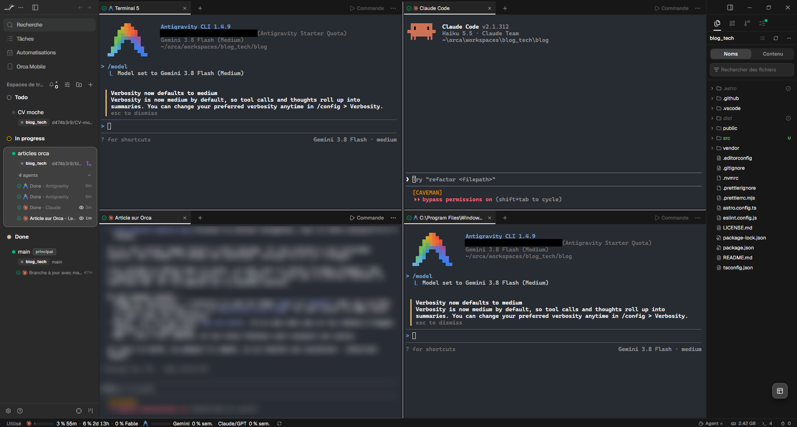
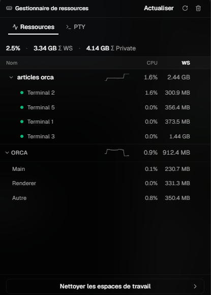
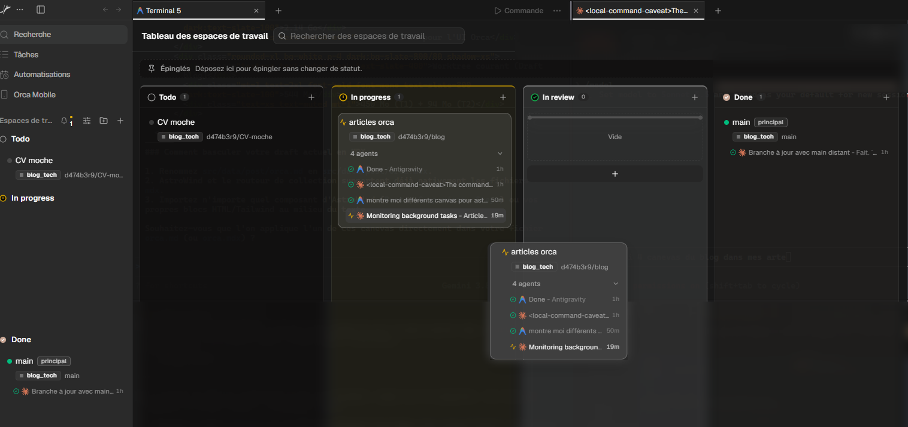

<div class="tldr">

⚡ **TL;DR : l'article en 3 points**

- **Pourquoi je migre** : Orca range chaque tâche dans son propre git worktree, avec son terminal, son navigateur et l'état de son agent. Les agents arrêtent de se marcher dessus.
- **Les killer features** : voir quel agent fait quoi et ce qu'il consomme sur ma machine, deux kanbans (worktrees et agents), sélectionner, annoter ou dessiner dans le navigateur ce que je veux modifier, et faire courir trois agents sur la même tâche (pas encore testé).
- **Ce qu'il fait moins bien** : la dictée vocale (Wispr Flow fait mieux), pas de vraie sandbox, pas de modèle intégré. PyCharm garde ses atouts.

</div>

Un agent de code seul dans un dépôt, c'est confortable. Trois agents dans le même dossier, c'est un open space sans cloisons : chacun écrit dans les fichiers des autres, et personne ne sait quelle branche est la bonne. Orca installe les cloisons.

Je cherchais un moyen efficace d'organiser mon travail : passer d'une tâche longue, menée par une équipe d'agents, à une autre sur le même dépôt, sans que les agents se prennent les pieds dans le tapis. Jusque-là, j'attendais la fin de la tâche, ou je basculais sur un autre dépôt le temps qu'elle se termine.

Je suis en train de migrer de PyCharm vers Orca. Pas contre PyCharm, qui reste un excellent IDE : parce que ma façon de travailler a changé. Voici ce qui m'a fait basculer.



_L'interface d'Orca : les worktrees par statut, quatre agents en parallèle, l'arborescence du dépôt_

## Killer feature 1 : un worktree par tâche, et les agents arrêtent de se marcher dessus

Un dépôt git n'a qu'un répertoire de travail et une branche active à la fois. Deux agents qui modifient le même dossier se gênent. La parade existe depuis longtemps dans git : le worktree, un second répertoire de travail rattaché au même dépôt, avec sa propre branche.

```bash
git worktree add ../feature-export -b feature-export
```

_Un worktree par tâche, à la main_

Le faire à la main pour chaque tâche, ouvrir un terminal par dossier, lancer l'agent, suivre qui a fini : c'est de la plomberie. Orca la prend en charge. D'après son site, chaque tâche tourne dans son propre git worktree. Un worktree peut avoir des enfants, se rattacher à une issue ou à une PR, s'épingler en haut de la liste ou être mis en veille depuis la barre latérale.

**Le détail Python.** Un worktree ne contient que les fichiers suivis par git. Votre `.venv`, ignoré, n'y est pas : chaque worktree demande son propre environnement. Sur un projet Python, comptez donc une création d'environnement par worktree. Pour l'instant, ce coût ne me gêne pas : je ne l'ai pas chiffré, et je le surveillerai sur les projets lourds.

Côté création, la fenêtre « Créer un worktree » demande le projet, la référence de départ (`origin/main` par défaut, ou une issue GitHub, une branche, un simple nom) et, en option, l'agent à lancer dedans.

## Killer feature 2 : savoir quel agent fait quoi, à quel moment, et ce qu'il coûte à la machine

C'est la fonction qui change le plus mon quotidien. Avec plusieurs agents en parallèle, la question n'est plus « que fait mon agent ? » mais « lequel fait quoi, depuis quand, et lequel attend après moi ? ». Orca y répond à plusieurs niveaux.

- **Sur chaque carte de worktree** : un indicateur d'état. Une roue pour « au travail », un point d'interrogation ambre pour « attend votre réponse », un point vert pour « terminé », un point rouge pour « bloqué ou en échec », un point gris pour « inactif ».
- **L'Agent Dashboard** : un kanban des agents, tous worktrees confondus, avec les colonnes « Needs You », « Working », « Done » et, en option, « Idle ». Recherche, filtres par projet, par statut de worktree et par statut de PR, ouverture dans la fenêtre ou en fenêtre séparée. Il est expérimental : il s'active dans Settings → Experimental.
- **L'Agents feed** : un fil chronologique des fins de tour, des questions bloquantes et des créations de worktree, avec un aperçu de la dernière réponse de chaque agent. Les agents au travail restent épinglés en haut.
- **Le Resource Manager** : un indicateur de la barre d'état qui affiche la consommation du processeur et de la mémoire, les sessions, les contrôles du daemon et des analyses d'espace disque par workspace. C'est lui qui répond à « combien ils consomment sur ma machine ».
- **L'hibernation** : quand vous gardez des dizaines de worktrees ouverts, chaque agent inactif est un terminal vivant qui garde une session en mémoire. Orca peut mettre en pause ceux qui ont fini depuis un certain temps (30 minutes par défaut, réglable de 1 minute à 24 heures) et reprendre la même session à la réouverture. Elle est expérimentale et désactivée par défaut, et ne concerne que les agents capables de reprendre une session.

Côté CLI, `orca diagnostics memory` produit un instantané mémoire d'Orca et de ses terminaux.

Voici ce que donne le Resource Manager (« Gestionnaire de ressources » dans l'interface française) sur ma machine, avec un espace de travail actif : un onglet Ressources et un onglet PTY, une ligne par worktree puis par terminal, et en bas Orca lui-même.



_Le gestionnaire de ressources : processeur et mémoire par worktree, par terminal, et pour Orca lui-même_

Dans cet exemple : 3,34 Go de mémoire au total, dont 2,44 Go pour le worktree sur lequel j'écris cet article, répartis sur quatre terminaux (de 301 Mo à 1,44 Go : un seul terminal pèse plus que les trois autres réunis). Orca lui-même pèse 912 Mo, dont 331 Mo pour l'affichage. Un seul espace, donc rien d'inquiétant, mais l'écart entre terminaux montre à quoi sert ce panneau : repérer lequel gonfle. Avec dix agents en parallèle, il prendra tout son sens. Un bouton « Nettoyer les espaces de travail » et une analyse de l'espace disque (en bêta) complètent le tout.

Précision utile : il s'agit de la consommation de **votre système**, pas de la facture en tokens d'une exécution. Orca suit l'usage de certains abonnements d'agents et leurs limites de débit, et la vue chat de certains agents affiche un anneau de remplissage de la fenêtre de contexte. Il ne chiffre pas le coût d'une exécution.

## Killer feature 3 : les worktrees en kanban

Il y a en fait deux kanbans. Celui des agents, décrit plus haut, et celui des **worktrees**, le Workspace Board. Chaque worktree est une carte, et les colonnes par défaut sont `todo`, `in-progress`, `in-review` et `completed`. Les statuts peuvent aussi se changer depuis la CLI, donc un agent peut déplacer sa propre carte :

```bash
orca worktree set --worktree active --workspace-status in-review --unread
```

_Passer le worktree courant en revue_

Une ligne de commentaire, modifiable avec `--comment`, s'affiche sur la carte. Le raccourci « Toggle Workspace Board » n'est lié à aucune touche par défaut : à assigner dans Settings → Shortcuts. Pour quelqu'un qui jongle avec cinq tâches, c'est plus lisible qu'une pile de terminaux.

Chez moi, j'ouvre le kanban par-dessus mon terminal, comme sur cette capture. Je clique sur une carte, je la glisse d'une colonne à l'autre (Todo, In progress, In review, Done), et la zone « Épinglés » en haut permet de garder une carte à portée sans changer son statut. Je commence tout juste à m'en servir : pour l'instant, mes trois worktrees tiennent sur un coup d'œil.



_Le kanban des worktrees ouvert par-dessus le terminal : une carte glissée entre deux colonnes_

## Killer feature 4 : le navigateur où l'on montre à l'agent ce qu'on veut

Orca embarque un navigateur Chromium par worktree. Il sert à voir ce que l'agent construit sans quitter la tâche. Et c'est la fonction qui m'a le plus plu : on y montre à l'agent ce qu'on veut, de trois façons.

- **Sélectionner un élément, chirurgicalement.** Le Design Mode transforme le curseur en sélecteur. Un clic sur un élément envoie à l'agent, comme une seule pièce jointe, son HTML (et celui de son voisinage), son CSS calculé, une capture recadrée et, quand une source map de développement existe, le fichier et la ligne source.
- **L'annoter.** Un plateau d'annotations permet de garder plusieurs notes sur la page, chacune avec son commentaire, avant de les envoyer à l'agent.
- **Dessiner sur la capture.** Le bouton « Dessiner sur la capture d'écran » ouvre une barre d'outils : crayon, surligneur, flèche, rectangle, cercle, texte, gomme, couleur, taille, annuler et rétablir. Vous entourez la zone, vous flèchez l'élément, vous écrivez à côté ce que vous voulez, puis « Copier le markup » et vous le collez dans votre agent.


_Dessin sur la capture : le titre entouré et une flèche, prêts à être copiés vers l'agent_

Fini le « le bouton en haut à droite, non, l'autre ». L'agent corrige le code, le rechargement à chaud rafraîchit la page, et vous vérifiez en recliquant. La documentation promet un parcours complet en quelques minutes, du retour visuel jusqu'au commit. Sur mon essai, l'aller-retour entre le dessin et la correction est effectivement très court.

Mon essai : sur la page d'accueil de ce blog, j'ai entouré le titre « DataStart » et tracé une flèche vers la droite, pour demander de déplacer le bloc titre à droite de la carte de l'article. L'agent a modifié la page, je l'ai vue se rafraîchir, puis j'ai annulé : c'était pour la démonstration.

## Killer feature 5 : faire courir trois agents sur la même tâche

La documentation d'Orca propose un scénario phare : même prompt, trois worktrees, trois agents différents, et vous gardez le gagnant.

1. Créer trois worktrees depuis la même référence.
2. Lancer un agent différent dans chacun.
3. Coller le même prompt dans les trois.
4. Relire les trois diffs une fois terminés et garder le gagnant.
5. Commit, push et PR depuis le worktree retenu, puis supprimer les deux autres en un clic.

L'argument de la documentation : des agents différents font des erreurs différentes. Là où les trois s'accordent, la réponse est probablement juste. Là où ils divergent, vous avez trouvé le point dur.

Je ne l'ai pas encore essayée. C'est mon prochain test : la même fonctionnalité dans trois worktrees, avec trois modèles différents, pour mesurer leur efficacité et les challenger entre eux. Je ferai le même exercice pour comparer les nouveaux modèles, en mono-agent et en multi-agents.

## Et aussi : la CLI, pour que l'agent pilote son propre poste de travail

Orca livre une CLI `orca`, et elle n'est pas réservée aux humains. Un agent peut s'en servir pour créer un worktree, lire ou écrire dans un terminal, piloter le navigateur.

```bash
orca status
orca worktree list
orca worktree current
orca worktree ps
```

_État d'Orca puis inventaire des worktrees_

Au-dessus, deux couches : `orca orchestration` (tâches, DAG, workers supervisés, _decision gates_) et `orca automations` (déclencheur cron ou RRULE, avec une vérification préalable). L'orchestration est générique : pas de rôles prédéfinis comme « chef de projet » ou « reviewer ». Vous définissez les vôtres.

Je n'ai pas encore eu le temps de tester l'orchestration ni les automatisations. L'intérêt que j'y vois : tout faire dans le même outil, proprement.

## Et aussi : Orca Mobile, une télécommande pour vos agents

Orca a une application mobile, que j'utilise. Elle ne remplace pas le bureau : la [documentation](https://www.onorca.dev/docs/mobile) la présente comme une télécommande, et la dit encore en bêta. Elle s'appaire avec le poste par un code à usage unique, de préférence via le mode Orca Relay, qui demande un compte.

Ce qu'elle permet : recevoir une notification quand un agent a fini, répondre à un agent qui attend (« continue », « yes », un texte libre, une photo ou un fichier), suivre l'état des worktrees, consulter un terminal, dicter une réponse, et même commiter. Pour qui lance une tâche longue et s'éloigne de son poste, elle répond à la bonne question : « est-ce qu'il attend après moi ? ». Une session directe ou locale se coupe en revanche quand l'application bureau est fermée.

**L'installation, côté plateformes.** Sur iPhone, c'est l'App Store. Sur Android, il n'y a pas de Play Store : il faut télécharger un fichier `app-release.apk` depuis la [page de téléchargement](https://www.onorca.dev/docs/android-apk), autoriser temporairement le navigateur à installer des applications inconnues (et, sur certains Samsung, désactiver « Auto Blocker » le temps de l'installation). C'est nettement moins confortable, et la page ne dit rien des mises à jour ni d'une publication sur le Play Store.

## Ce qu'il fait moins bien : la dictée vocale

Activer la dictée est simple : Settings → Voice, on choisit le micro, le mode (appui pour démarrer et arrêter, ou maintien pour parler) et un modèle de reconnaissance. Les modèles embarqués sont SenseVoice (chinois, anglais, japonais, coréen, cantonais) et Whisper Tiny (plus de 90 langues, que la documentation elle-même présente comme moins précis). On peut aussi brancher des modèles cloud d'OpenAI avec une clé d'API. Le compagnon mobile propose le micro pour répondre à un agent.

Concrètement, Wispr Flow fait mieux le job : il capte ma voix de façon plus fluide et plus fidèle.

Je ne suis pas le seul à le trouver rapide, avec une réserve de méthode. Un [test publié en avril 2026 sur digitiz.fr](https://digitiz.fr/wispr-flow/) annonce une latence sous les 700 millisecondes, une insertion quasi immédiate au curseur, la suppression des hésitations et un dictionnaire personnel qui apprend les noms propres et les termes techniques. Ses chiffres (une précision d'environ 97 %) ne sont pas sourcés, et le test ne couvre pas le français en particulier. Il relève aussi des limites : traitement dans le cloud, donc pas de mode hors ligne, environ 800 Mo de mémoire et une stabilité variable sous Windows.

Ce n'est pas rédhibitoire : un outil de dictée dédié se branche très bien à côté.

## Ce qu'Orca n'est pas

Certaines descriptions en ligne lui prêtent des fonctions qu'il n'a pas. Dans le README, la documentation et la CLI, je n'en ai trouvé aucune trace (une absence de mention ne prouve pas tout, mais elle pèse) :

- **Pas de vraie sandbox** : l'isolation est celle du worktree, fichiers et branches, pas celle d'un conteneur. Et par défaut, Orca lance chaque agent avec son drapeau de pleine autonomie, donc sans demandes de validation : l'idée de la documentation est que le worktree fait office de bac à sable. Un agent garde donc les droits de votre compte. Ce comportement se règle agent par agent dans Settings → Agents.
- **Pas de boutons d'approbation propres** : Orca montre quand un agent attend après vous (la colonne « Needs You »), mais les validations restent celles de l'agent.
- **Pas d'inspecteur de raisonnement** : pour comprendre ce qu'un agent a fait, vous lisez son terminal et ses diffs, ou vous cherchez dans l'historique des sessions.
- **Pas de modèle intégré** : Orca lance des agents qui apportent le leur, avec votre propre abonnement. Le site en nomme 27 (le README GitHub en cite davantage), dont Codex, Gemini, Cursor, Copilot et OpenCode. Ce n'est pas un IDE avec une IA dedans, c'est un poste de pilotage pour agents externes.

## Et PyCharm dans tout ça

PyCharm n'est pas resté en arrière : la documentation de PyCharm 2026.2 décrit un espace d'agents, via le plugin JetBrains Air (non activé par défaut), qui gère plusieurs sessions en parallèle, en local, dans le cloud ou dans un worktree temporaire.

Orca, lui, n'a pas de débogueur ni de refactorings d'un IDE dédié. Un [retour d'usage](https://angelo-lima.fr/en/orca-ide-agentic-development-en/) publié en septembre 2026 raconte la même chose avec IntelliJ : son auteur y garde ses refactorings et son débogage.

## Les limites

- **Dépendances dupliquées** : un worktree, c'est une copie des fichiers suivis, plus l'environnement à recréer. Le disque et la mémoire montent avec le nombre d'agents. Le retour d'usage cité plus haut le signale aussi, et c'est exactement ce que le Resource Manager et l'hibernation cherchent à contenir.
- **Plusieurs fonctions sont expérimentales** : l'Agent Dashboard, l'hibernation et la vue chat native sont à activer dans Settings → Experimental, et la documentation dit elle-même qu'elles évoluent.
- **Plus d'agents, plus à relire** : plus de diffs, plus de tokens consommés. Orca ne règle pas ça, il le rend visible.
- **Un projet jeune et rapide** : première release le 21 mars 2026, version 1.4.243 le 28 octobre 2026, soit plusieurs versions par jour en moyenne. Environ 4 100 issues ouvertes, et autant de PR (API GitHub, 28 octobre 2026). Surveillez la stabilité après chaque mise à jour.
- **Télémétrie** : des événements d'usage anonymes, désactivables.

De mon côté, aucune limite rencontrée pour l'instant. Je verrai s'il devient gourmand sur du travail très intensif.

## Installer et essayer

Orca est open source (licence MIT), gratuit, édité par Stably AI. Le dépôt est `stablyai/orca`, le site [onorca.dev](https://www.onorca.dev/), et le dépôt dépasse les 100 000 étoiles GitHub (API du 28 octobre 2026). Il tourne sur macOS, Windows et Linux.

```bash
brew install --cask stablyai/orca/orca
```

_Installation sur macOS_

Sous Windows et Linux, passez par les releases GitHub (exe, AppImage, deb, rpm).

> **Petit aparté.** « orca » est aussi le nom du lecteur d'écran de GNOME. Sous Linux, le binaire d'Orca s'appelle `orca-ide`, et plusieurs dépôts GitHub sans rapport portent le même nom. Vérifiez l'organisation `stablyai` avant d'installer.

## Ce que je retiens

Pour l'instant, je teste Orca sur mon PC personnel, en même temps que je donne une formation. Vendredi 30 octobre, je le migre sur mon poste professionnel. Ce que j'en attends : enchaîner des tâches longues sur un même dépôt sans qu'elles se gênent, et voir d'un coup d'œil qui fait quoi. Je referai le point après quelques semaines d'usage réel.

Un conseil : essayez Orca sur un petit dépôt, avec deux tâches indépendantes, avant de lui confier un vrai projet. Si deux agents avancent sans se gêner, vous aurez vu ce qu'il promet. Gollum, lui, n'a jamais su s'arrêter à un seul essai.
